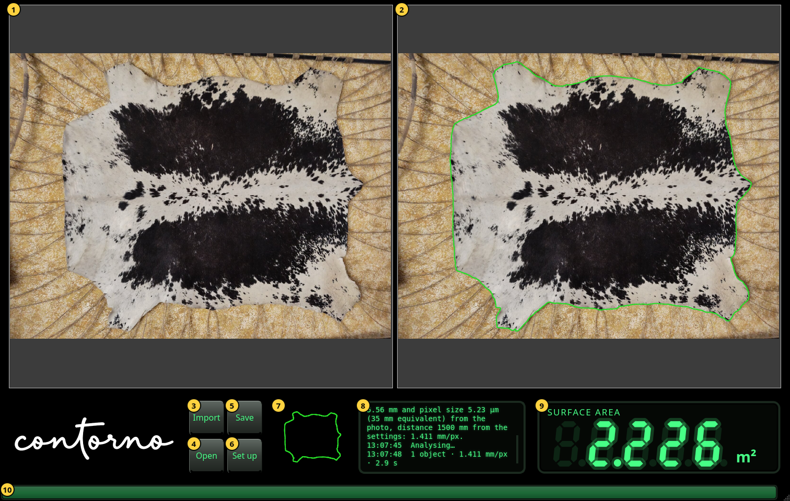

# Contorno

[](https://github.com/medaminben/Contorno/actions/workflows/ci.yml)

Contorno measures the surface of a flat animal hide from one photograph taken
straight down onto a table. The desktop application, **Contorno Indicator**,
finds the hide's outline with the IS-Net segmentation model, turns the pixels
inside it into square metres from the camera distance and the lens data, and
keeps the photograph, the mask and the outline as the record of each
measurement.



<sub>The yellow numbers are the user manual's labels. The cowhide is "Stretched
Cowhide Skin" by Enda012, [Wikimedia Commons](https://commons.wikimedia.org/wiki/File:Stretched_Cowhide_Skin.jpg),
[CC BY 4.0](https://creativecommons.org/licenses/by/4.0/), reduced in size.</sub>

## What it does

- Reads a JPEG, PNG, TIFF or BMP photo and its EXIF camera data; the distance
  to the table and, where EXIF lacks them, the focal length and sensor size
  come from the set-up.
- Outlines the hide with IS-Net, and finds it from the background instead when
  the network misses parts of a two-tone hide.
- Shows the area in m² (cm² for small objects), and exports an inspection archive with the
  photo, the mask and the outline as DXF for CAD and cutting.
- Runs offline. The interface and the manual are in English, Deutsch, Español,
  Italiano, Français, Nederlands and العربية.

How accurate the area is, and why, is the subject of the article
[*Measuring the surface of animal hides from a single photograph*](docs/articles/contorno-area-measurement/contorno-area-measurement.pdf).

## Status

Contorno is in development. It is built and tested on Linux (Debian 13,
GTK 3). There are no installers yet; build it from source as below.

## Building

Requirements: a C++20 compiler (developed with g++ 14), CMake 3.29 or newer,
Ninja, wxWidgets 3.2, OpenCV 4, gettext, and Python 3 with venv for the model.
On Debian or Ubuntu:

```sh
sudo apt install g++ ninja-build libwxgtk3.2-dev libopencv-dev gettext python3-venv
```

LibTorch 2.12 (CPU) is used from `/opt/libtorch` or downloaded during
configure. The build tooling comes from [buildkit](https://github.com/medaminben/buildkit),
fetched automatically, or taken from `../buildkit` when it is there.

```sh
cmake --preset default
cmake --build --preset default --target isnet_model   # once: exports the AI model (downloads about 1 GB)
cmake --build --preset default
ctest --preset default
build/default/bin/Indicator
```

The presets are `default` (release), `debug`, `coverage`, `asan` and `ci`;
each builds into `build/<preset>`. Without LibTorch the program still builds,
and says on screen that it cannot measure.

## Documentation

| Document | For |
|---|---|
| [User manual](docs/manual/content/en/) | operators; built into `docs/manual/index.html` and opened from the program |
| [Architecture](docs/architecture/architecture.md) | engineers who build, change or review Contorno |
| [Area measurement article](docs/articles/contorno-area-measurement/contorno-area-measurement.pdf) | the method, its error budget and its limits |
| [Implementation paper](docs/articles/contorno-indicator/contorno-indicator.pdf) | how the Indicator is built and checked |
| [Sample images](docs/samples/image-sources.md) | the origin and licence of every photo in the repository |

## Contributing

Issues and pull requests are welcome; read [CONTRIBUTING.md](CONTRIBUTING.md)
first. Security problems go through [SECURITY.md](SECURITY.md), not public
issues. Everyone taking part follows the [code of conduct](CODE_OF_CONDUCT.md).

## Licence

Copyright © 2026 Mohamed Lamine Ben Hassine. All rights reserved; see
[LICENSE](LICENSE). The sample photographs keep their own licences.
