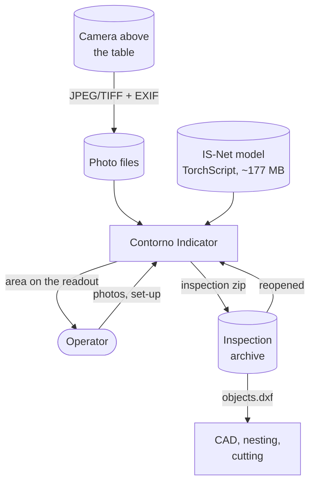
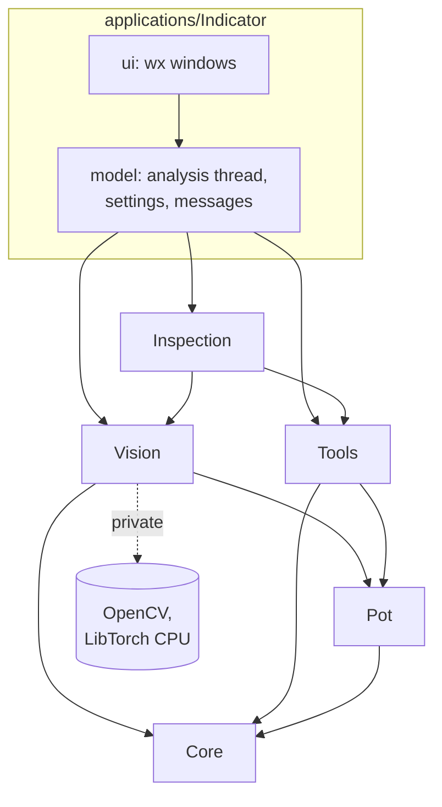
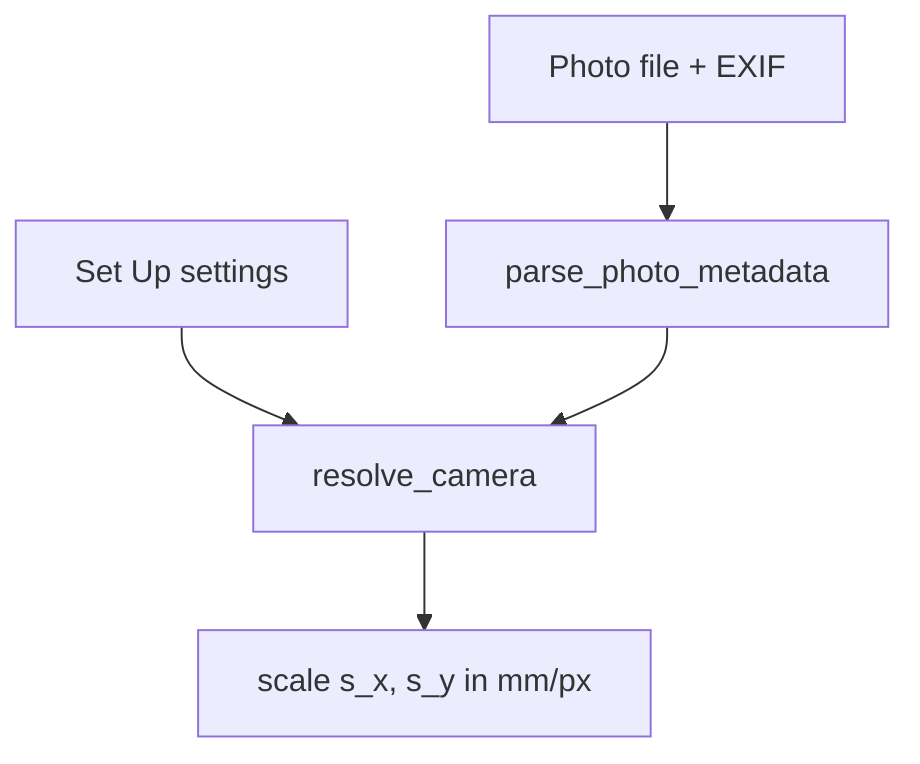
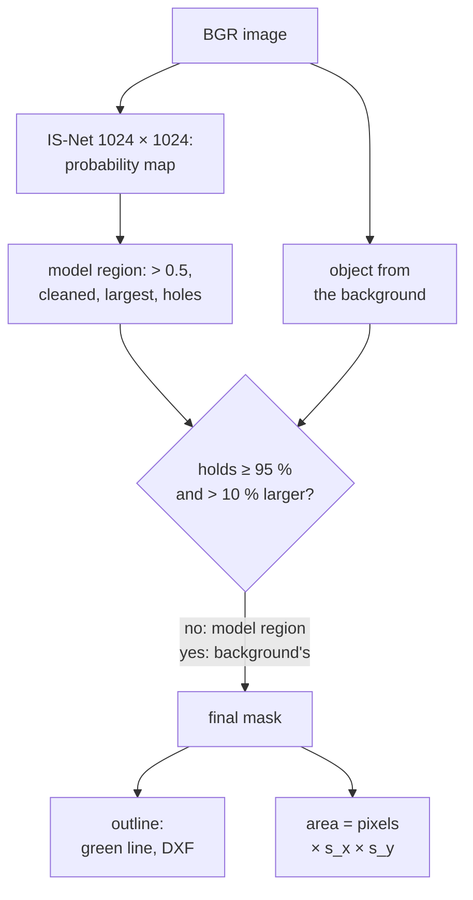
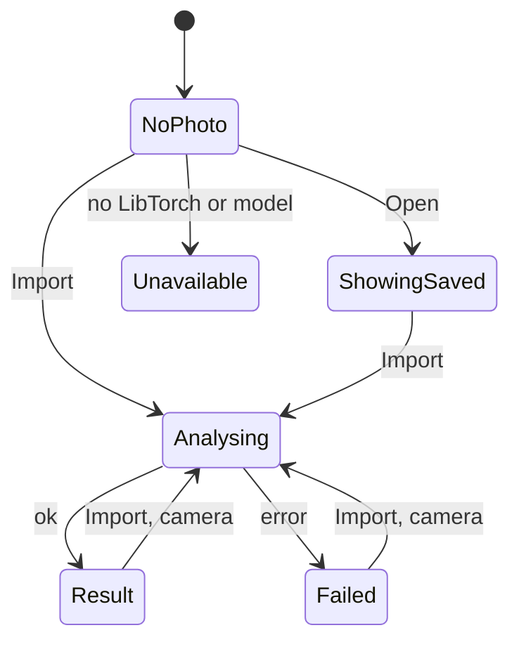

# Contorno: architecture and structure

Status: as of 2026-11-07.
Audience: engineers who build, change or review Contorno.

Contorno measures the surface of a flat object, chiefly an animal hide, from
one photo taken straight down. The product today is the desktop application **Contorno Indicator**,
on wxWidgets 3.2 (§3.6), built on five C++ libraries. This document describes
what each part does, how the parts depend on each other, the data that flows
between them, the files they exchange, and how the whole is built, tested and
installed.

The physics of the measurement (the camera model, the error budget) is
treated in depth in the article `docs/articles/contorno-area-measurement/contorno-area-measurement.md`;
here it appears only where it shapes the software.

---

## 1. System context



**Boundary.** Contorno does not drive the camera. It takes photo files, so
any camera can be used and the photo is the evidence of each measurement.
It does not position or move the hide. It does not use the network at run
time: the model and the manual are local files.

**Stakeholders.** The operator at the measuring table (reads the area,
saves inspections), the quality or sales side that relies on the area (hides
are traded by surface), and downstream CAD/cutting that consumes the outline.

---

## 2. Repository layout

```
Contorno/
├── CMakeLists.txt         top level: options, libraries, applications
├── cmake/                 OpenCV, LibTorch, GTest, the IS-Net export
│                          target, library scaffolding
├── libraries/             the measuring core, no UI toolkit
│   ├── Core/              Result<T>, Problem (error code + values); header only
│   ├── Pot/               integer polygon geometry (1 unit = 1 µm)
│   ├── Tools/             zip, JSON, DXF readers and writers
│   ├── Vision/            camera model, EXIF, AI segmentation, outline, area
│   └── Inspection/        the inspection zip format
├── applications/
│   └── Indicator/         the desktop application, wxWidgets (§3.6)
│       ├── src/model/     state, analysis thread, settings, messages (no toolkit)
│       ├── src/ui/        wx windows and drawn controls
│       ├── strings/       one string table per language
│       ├── cmake/         wx's own catalogues, embedded
│       ├── resources/     icons, wordmark, desktop entry
│       └── test/          model tests and window tests
└── docs/
    ├── architecture/      this document
    ├── articles/           the scientific article, its scripts (including
    │                      the IS-Net export) and the model comparison
    ├── manual/            the user manual: sources, generated HTML,
    │                      build_manual.py
    ├── samples/           sample photos for the tests and the article,
    │                      with their sources and licences
    └── brand/             the original drawings of the logo and wordmark
```

---

## 3. Layered architecture



The ui layer uses wxWidgets 3.2 (GTK 3 on Linux). The model layer is plain
C++20, with no UI toolkit. LibTorch is optional.

Rules the code keeps (enforced by build structure and tests):

| Rule                                                                | How it is held                                                                                                                                                        |
| ------------------------------------------------------------------- | --------------------------------------------------------------------------------------------------------------------------------------------------------------------- |
| Libraries do not depend on a UI toolkit.                            | No Qt and no wxWidgets in any `libraries/*/CMakeLists.txt`.                                                                                                        |
| OpenCV and LibTorch never appear in a public header.                | Both are `PRIVATE` dependencies of Vision; only `Ai_impl.cpp` includes torch.                                                                                     |
| A build without LibTorch still compiles, runs and passes its tests. | `BUILD_VISION_AI`, `CONTORNO_WITH_TORCH`; `ai_available()`; tests skip what needs the model.                                                                    |
| The Indicator's model layer has no widgets.                         | `indicator_model` links the Contorno libraries only, so a widget header does not compile there; `WxLayers.ModelHasNoToolkit` checks no model file includes a Qt or wx header. |
| Library errors are data, not English sentences.                     | `Core::Problem` carries a code and named values; the application translates by code (`LibraryText`).                                                              |
| Public library functions do not throw.                              | `noexcept` wrappers return `Result<T>` and turn exceptions into errors.                                                                                           |

### 3.1 Core

Header only. `Result<T>` holds either a value or an `Error<Problem>`; a
`Problem` is a code (`"camera.distance"`), an English template (`"distance must be positive and finite"`) and named values (`{path}`, `{range}`).
Wrong-side access is reported, never thrown.

### 3.2 Pot

Polygon geometry on an **integer grid of 1 µm** (`units_per_mm = 1000`):
`Point64`, `Path64` (closed ring), `Polygon64` (outer ring counter-clockwise,
holes clockwise). Integer coordinates make the geometry exact and the saved
outline bit-for-bit reproducible.

### 3.3 Tools

Self-contained readers and writers with bounded, defensive parsing:

- **Zip** (`to_zip`, `write_zip`, `parse_zip`, `read_zip`): stored entries
  only, CRC-32 checked, rejects absolute names, `..`, duplicates, encryption,
  split archives and oversize archives.
- **JSON** (`parse_json`, `to_json_text`): own parser with depth limit,
  UTF-8 and surrogate validation.
- **DXF** (`to_dxf`, `parse_dxf`): polygons as closed polylines on a named
  layer, read back for verification.

### 3.4 Vision

The measuring core. Public headers and their roles:

| Header        | Role                                                                                                                                                                     |
| ------------- | ------------------------------------------------------------------------------------------------------------------------------------------------------------------------ |
| `Camera.h`    | `PixelFrame` (mm per pixel along x and y), `to_mm`, `to_px`; `CameraConfig` and `mm_per_px`: the old field-of-view model, the oracle of the legacy-migration tests.      |
| `Lens.h`      | `LensCamera` (distance, focal length, pixel width and height), `CameraSettings` (sensor or pixel mode), `lens_scale`, `to_camera_config` (only for the `fov_deg` in `camera.json`), `sensor_pixel_um`. |
| `Photo.h`   | EXIF reader (`parse_photo_metadata`, JPEG APP1 and TIFF) and `resolve_camera`: the photo's values where valid, else the settings, with the source of each and notes. |
| `Objects.h`   | `find_objects(image, scale, options)`: the AI outline and area at the given mm/px; `min_area_pct`, presets, `ai_available()`.                                            |
| `Image.h`   | shown size of a photo (EXIF orientation applied), mask PNG encode/decode.                                                                                                |

### 3.5 Inspection

The inspection zip format, independent of the UI toolkit: `to_entries(record, analysis)`
and `from_entries(entries)`. It owns the JSON schemas and their versions
(section 6).

### 3.6 Indicator

`applications/Indicator` is the desktop application, on wxWidgets 3.2 (GTK 3
on Linux). Two static libraries in one CMake project, then the executable
`Indicator`.

- **model** (`indicator_model`): plain C++20, with no Qt and no wx. Text is
  UTF-8 `std::string`, paths are `std::filesystem::path`. `Analyser` (the
  worker thread) takes a `post` function to hand its result back; the ui
  passes `wxTheApp->CallAfter`, so the result arrives on the GUI thread.
  `IndicatorSettings` (INI), `Inspection` glue, `CameraMessage`, `Message`
  (a key plus values, nested messages allowed), `Language` (string tables),
  `LibraryText` (library `Problem` → message), `ModelPath` (where the IS-Net
  file is), `ManualLocation` (where the manual is, and how a browser opens
  it), `Measure` (readout formatting), `ImageSize` (a photo's shown size).
  Settings go through the `SettingsStore` interface: the app stores them
  with `WxConfigStore`, the tests with an in-memory store. The seven string
  tables live in `strings/` and compile against this model's `Language.h`.
  `WxLayers.ModelHasNoToolkit` checks that no model file includes a Qt or wx
  header.
- **ui** (`indicator_ui`): `MainWindow` (two linked photo views, the control
  panel, the status bar), `ControlPanel` (wordmark, four keys, mask, log,
  readout), `CameraDialog` (Set Up: camera, language, theme, manual),
  `SegmentDisplay` (seven-segment readout), `MessageLog`, `PhotoView`,
  `Theme`, `Localise`, `FlagIcons`, `AppIcon`, plus `Key` (the raised keys),
  `NumberField`, `ProgressBar`, `FileDialog` (a themed `wxDialog` around
  `wxGenericFileCtrl`, which takes the theme where the GTK dialog would not),
  `Catalogue` and `Fonts`. Native controls are used where GTK takes the
  theme's colours. The keys, readout, log and progress bar are drawn by
  hand. The panel is a `wxPanel` in the theme colour.

The test executables are `test_indicator_model` (no display, CTest label
`unit`) and `test_indicator` (a display, `GDK_BACKEND=x11`, label `unit`).
The ctest target `indicator_self_test` runs the real `Indicator` with
`GDK_BACKEND=x11`. GoogleTest names keep a `Wx` prefix (`WxWindow`,
`WxInspection`, …).

The installed names are the executable `Indicator`, the desktop entry and
icons `contorno-indicator`, the GTK application id `contorno-indicator`,
the target `Indicator_desktop_entry`, and the settings file of §6.2. The
model, the manual and the article are installed with the application.

wx's own texts (those of the file dialog) come from wx's catalogues, which
`applications/Indicator/cmake/WxCatalogue.cmake` compiles into the
executable for de, es, it, fr, nl and ar. It takes the machine's `wxstd.mo`
for a language; when that is missing, it downloads wx's `locale/<lang>.po`,
checks it against a pinned SHA-256 (for wx 3.2.8) and compiles it with
`msgfmt`. Offline or without `msgfmt` the build warns and those texts stay
in English.

`BUILD_WX_UI` (on by default) builds the app, through buildkit's
`create_application(ENTRY WX_ui)`; `ContornoTargets` hands that entry on
to buildkit's original. Without wxWidgets, or with `BUILD_WX_UI` off, the
app and its tests are skipped and the rest builds.

---

## 4. The measurement chain

From photons to the number on the readout, and where each step lives:

**The scale**, from the photo's camera data and the settings:



**The outline and the area**, from the image:



| Step      | Code                          | Notes                                                                                                                                                                                                                |
| --------- | ----------------------------- | -------------------------------------------------------------------------------------------------------------------------------------------------------------------------------------------------------------------- |
| EXIF      | `Vision/Photo.cpp`          | FocalLength, FocalPlaneX/YResolution + unit, PixelX/YDimension, FocalLengthIn35mmFilm. Never reads out of bounds.                                                                                                    |
| Camera    | `resolve_camera`            | Distance always from the settings. Focal length valid in [0.1, 2000] mm, pixel size in [0.1, 100] µm, else the setting; a note says why.                                                                            |
| Scale     | `lens_scale`               | `s_x = d · p_x / f`, `s_y = d · p_y / f`; x and y swap for a photo shown rotated by 90°.                                                                                                                      |
| Inference | `Ai_impl.cpp`               | RGB, bilinear to 1024×1024, `x/255 − 0.5`, TorchScript forward on CPU, min–max normalisation (skipped when nothing reaches the threshold), bilinear back to W×H. The module is cached per path behind a mutex. |
| Mask      | `Objects_impl.cpp`, `Segment_impl.cpp` | Threshold 0.5; `clean_mask_impl` removes one-pixel spurs and diagonal-only contacts so contours are simple.                                                                                                        |
| Region    | `Objects_impl.cpp`          | Largest 8-connected region at or above the minimum area (100 mm² by default, as a % of the photo).                                                                                                                  |
| Holes     | `Objects_impl.cpp`          | A hole stays only if it is at least the minimum area **and** its mean probability is under 0.2 (the model sees the table through it). Marks on the hide are filled.                                            |
| Whole hide | `background_object_impl` (`Segment_impl.cpp`), `Objects_impl.cpp` | The model can take the dark patches of a spotted or speckled hide for the object. The object is also found from the background: on a 160 px copy, median-filtered (lines of a cutting mat or planks removed), the background is fitted from the border band (lightness and shadow-invariant colour, with uneven light and vignetting) and grown from the border; the edge is then placed at full size by a watershed in a band of 2.5 coarse pixels. It replaces the model's region when it holds ≥ 95 % of it and is more than 10 % larger; `ObjectsAnalysis::from_background` then says so, and the Indicator adds a line asking to check the outline. It cannot work where the border is not background (a hide reaching the frame, a mat smaller than the frame): there the model's region stands. |
| Outline   | `trace_polygon_impl` (`Segment_impl.cpp`) | `findContours` (RETR_CCOMP), simplified within 0.5 mm, epsilon halved until the polygon is simple; mapped to the image mm frame.                                                                                   |
| Area      | `Objects_impl.cpp`          | `countNonZero(mask) × s_x × s_y`: the readout equals the white of the saved mask exactly.                                                                                                                        |

---

## 5. Run-time behaviour of the Indicator

### 5.1 Threads

The GUI thread owns all widgets. `Analyser` runs `find_objects` on **one
worker thread**, one analysis at a time. A request made during a run waits;
a newer request replaces a waiting one; the result of a run made stale by a
newer request is dropped. Results return to the GUI thread by a queued
signal. IS-Net through rembg (ONNX), its whole `remove()` call, took
1.48–1.64 s per photo on the development CPU (4 cores, 8 threads, no GPU); one
TorchScript forward of the app's model took 1.822 s (4 threads, 1024 × 1024)
(`docs/articles/contorno-area-measurement/model_comparison/README.md`). The
whole analysis, background check included, took a median of 2.3 s at
1600 × 1200 and 7.5 s at 4000 × 3000 in the article's Python implementation
(article §3.5); the Indicator logs its own time with each result, plus a
one-time model load.

### 5.2 Operating states



At start the settings, the language and the theme are loaded. An `Import`
or a camera change during an analysis starts a new one, and the newest
wins. In *Unavailable* every `Import` shows the photo without an area.

| State        | Readout                            | Save               | Busy bar             |
| ------------ | ---------------------------------- | ------------------ | -------------------- |
| NoPhoto      | dashes                             | refused: no result | idle                 |
| Analysing    | previous value dimmed              | refused: wait      | moving               |
| Result       | area, bright                       | allowed            | full 1 s, then fades |
| ShowingSaved | saved area                         | allowed            | idle                 |
| Failed       | dashes; message + warning          | refused            | idle                 |
| Unavailable  | dashes; "AI outline unavailable…" | refused            | idle                 |

The anti-goal behind *Unavailable*: no silent fallback. The AI outline is
the only method; without it the application says so and measures nothing.

### 5.3 Languages

Seven interface languages: `en de es it fr nl ar`. Strings live in code
tables (`strings/indicator_<code>.cpp`), keyed by dotted names, with
`{placeholders}`. Numbers with units are never translated (Latin digits,
`.` decimal). Arabic sets right-to-left on dialogs, the log and the key
labels; the main window's geometry never mirrors. The message log stores
messages, not text, so old lines re-render in a new language with their
original times. Tests check parity of keys and placeholders across tables
and that every key used in the sources exists.

### 5.4 The manual and the ? key

The ? in the Set Up dialog opens the user manual in the **dialog's**
language (`ManualLocation.h`, `CameraDialog::open_manual`):

1. `find_manual`: first existing of
   `<exe>/../share/contorno/manual/<lang>/index.html`,
   `<source>/docs/manual/<lang>/index.html`, then the same for English, then
   the language chooser.
2. A Chromium-family browser as an app window with a private profile
   (`chromium`, `chromium-browser`, `google-chrome`, `google-chrome-stable`
   on Linux; Edge on Windows), sized 1200×800 and centred on the dialog's
   screen; else the system's default browser; else a warning naming the file.

---

## 6. Interfaces and file formats

### 6.1 Inspection zip

Written by `Inspection::to_entries`, in this order:

| Entry               | Format                          | Version | Content                                                                                                       |
| ------------------- | ------------------------------- | ------- | ------------------------------------------------------------------------------------------------------------- |
| `original.<ext>`  | the photo's bytes               | –      | untouched; no annotated image is ever saved                                                                   |
| `mask.png`        | 8-bit grey PNG                  | –      | object 255, rest 0, photo size                                                                                |
| `camera.json`     | `contorno-camera`             | 4       | distance, focal length, pixel width and height, their sources (`photo`/`settings`), derived fov and width |
| `parameters.json` | `contorno-objects-parameters` | 1       | `min_area_mm2`, `outline_tolerance_mm`                                                                    |
| `objects.dxf`     | DXF                             | –      | outer ring and holes, image mm frame, layer `OBJECT` (omitted without objects)                              |
| `result.json`     | `contorno-objects-result`     | 2       | image size, `mm_per_px_x`, `mm_per_px_y`, `area_mm2`, rings                                             |

Reading accepts camera.json v1–v4 (v1–v3 as square pixels) and result.json
v1–v2; older hide inspections (`contorno-hide-*`, `conqueror-*`) give the
photo and camera only and are analysed again. `mask.png` must match the
image size and hold only 0 and 255.

**Coordinate frame.** Image mm frame: x to the right, y **up**, origin at
the photo's bottom-left; a pixel (col, row) maps to
`((col + 0.5)·s_x, (H − row − 0.5)·s_y)`.

### 6.2 Settings (`indicator.ini`)

On Linux the file is `$XDG_CONFIG_HOME/Contorno/Indicator/indicator.ini`, or
`~/.config/Contorno/Indicator/indicator.ini`. Keys: `camera/distance_mm`, `camera/focal_length_mm`, `camera/sensor_input`
(`pixel` | `sensor`), `camera/pixel_width_um`, `camera/pixel_height_um`,
`camera/sensor_width_mm`, `camera/sensor_height_mm`, `objects/min_area_mm2`,
`ui/language`, `ui/theme` (`dark` | `light`), `dialogs/last_folder`, `ai/model_path` (not in the
UI). Older keys migrate (`camera/fov_deg`, `camera/pixel_size_um`,
`camera/sensor_width_px`) keeping their scale.

### 6.3 Model

TorchScript module, input `[1, 3, 1024, 1024]` float32, output
`[1, 1, 1024, 1024]` sigmoid probability. Exported by
`docs/articles/contorno-area-measurement/scripts/model/export_isnet.py` (the
article's own export script) from the DIS IS-Net "general use" weights
(code Apache-2.0; the weights' mirror declares Apache-2.0, the original
repository states no licence for them) with a pinned URL and SHA-256; `torch==2.12.0` to match
LibTorch 2.12.0.

---

## 7. Error handling and failure modes

| Failure                                         | Detection                                         | Response                                                                          | Evidence                                         |
| ----------------------------------------------- | ------------------------------------------------- | --------------------------------------------------------------------------------- | ------------------------------------------------ |
| LibTorch absent at build                        | `ai_available()` false                          | photo shown, "AI outline unavailable: Vision was built without LibTorch", no area | `WxWindow.UnavailableSaysWhy`, self-test exit 77 |
| Model file missing                              | `find_model` empty                              | message lists the places looked in and the fix                                    | `WxModelPath.*`                                |
| Model corrupt / wrong shape / non-finite output | torch error, shape and `checkRange` checks      | analysis fails with a translated error                                            | `Objects.CorruptModelIsAnError`                |
| Unreadable photo                                | `cv::imread` empty                              | failed import keeps the previous state                                            | `WxWindow.FailedImportKeepsState`              |
| Camera value out of range                       | range checks in `resolve_camera`                 | photo value rejected → setting used, note in the camera line                     | `PhotoCamera.*`, `WxCameraMessage.*`          |
| Invalid scale reaching `find_objects`           | the scale check in `find_objects`                | analysis fails with a translated error (code `camera.scale`): "the scale must be positive and finite" | `Objects.InvalidScaleIsAnError`               |
| Cropped photo in sensor mode                    | aspect ratio differs > 2 %                        | note "the photo may be cropped"                                                   | `PhotoCamera.*`                                |
| Damaged or hostile zip                          | Tools zip validation                              | open refused with the entry and reason                                            | `Zip.*`, `WxInspection.*`                    |
| Stale result after a new import                 | request ids                                       | old result dropped; readout dimmed until the new one                              | self-test "import while busy"                    |
| Nothing on the table                            | no region ≥ minimum                              | success, 0 area, "No object found"                                                | `Objects.EmptyTableHasNoObjects`               |
| Model took only part of the hide              | object found from the background holds ≥ 95 % of the model's region and is > 10 % larger | that object is measured; a line after the result asks to check the outline | `Objects.SpottedCalfIsTheWholeHide`, `WxWindow.OutlineFromTheBackgroundIsReported` |
| Marks on the hide read as holes                 | hole mean probability ≥ 0.2                      | hole filled                                                                       | `Objects.MarkedHideHasNoFalseHole`             |
| No browser for the manual                       | no candidate, launch fails                      | warning naming the manual file                                                    | `WxSetUpDialog.Help*`                          |

Errors from the libraries arrive as `Problem` codes and values and are
rendered in the current language by `LibraryText`; paths and third-party
exception text stay as they come.

---

## 8. Build

| Item      | Fact                                                                                                                                                                                                                                                         |
| --------- | ------------------------------------------------------------------------------------------------------------------------------------------------------------------------------------------------------------------------------------------------------------ |
| Toolchain | C++20, CMake ≥ 3.29, Ninja; developed on Debian 13 with g++ 14.2                                                                                                                                                                                            |
| buildkit  | `cmake/buildkit.cmake` loads buildkit v2.0.0 (`BUILDKIT_DIR`, else `../buildkit`, else fetched): warnings, GoogleTest, coverage, install config, version from the git tag `vX.Y.Z` (fallback 1.0.0). `ContornoTargets` and `ContornoScaffold` override its `create_library`, `create_application` and `generate_libraries` for header-only libraries and the `<Lib>/<Lib>_export.h` layout. Indicator uses buildkit's `create_application(ENTRY WX_ui)` |
| wxWidgets | 3.2 (GTK 3 on Linux), installed; found as buildkit's wx template does (`dev_dependency`); Indicator only |
| OpenCV    | `dev_dependency`: installed, else fetched with a pinned URL and SHA-256 (`CONTORNO_OPENCV_FETCH`)                                                                                                                                                       |
| LibTorch  | 2.12.0 CPU; `/opt/libtorch` or `Torch_DIR`, else downloaded (`CONTORNO_TORCH_FETCH`); a failed download warns and builds without AI                                                                                                                    |
| Model     | target `isnet_model` (not in `all`): Python venv, torch 2.12.0 CPU, pinned weights → `<build>/models/isnet-general-use.pt`                                                                                                                            |
| Options   | `BUILD_SHARED_LIBS`, `BUILD_APPS`, `BUILD_WX_UI`, `BUILD_VISION`, `BUILD_VISION_AI`, `BUILD_TESTING`, `ENABLE_COVERAGE`, `ENABLE_CLANG_TIDY`, `BUILD_VERBOSE_OUTPUT`, `GENERATE_SCAFFOLD`, `BUILDKIT_OFFLINE` (no downloads; `FETCHCONTENT_FULLY_DISCONNECTED` works too) |

```sh
cmake --preset default                              # or debug, coverage, asan, ci: build/<preset>
cmake --build --preset default --target isnet_model   # once: the AI model
cmake --build --preset default
ctest --preset default
```

The manual: edit `docs/manual/content/<lang>/*.md`, then
`docs/manual/build_manual.py`; `ctest` runs `build_manual.py --check`.

The article, with everything that makes it, is in `docs/articles/contorno-area-measurement`.
It stands on its own: its Python scripts implement the method again, and do
not use these libraries. `scripts/run_experiment.sh` (model, measurements and
figures; needs python3 with venv), then `scripts/build_article.sh` (pandoc
and Chromium: HTML and PDF).

---

## 9. Verification

| Suite                        | Tests | What it covers                                                                                                                                                   |
| ---------------------------- | ----- | ---------------------------------------------------------------------------------------------------------------------------------------------------------------- |
| `test_contorno_core`       | 18    | Result, Problem                                                                                                                                                  |
| `test_contorno_pot`        | 2     | geometry grid                                                                                                                                                    |
| `test_contorno_tools`      | 28    | zip (incl. archives written by Python), JSON, DXF                                                                                                                |
| `test_contorno_vision`     | 74    | camera and lens formulas, EXIF, AI outline on sample photos and its holes, the whole of spotted and speckled hides, non-square pixels |
| `test_contorno_inspection` | 14    | zip format, versions, legacy files                                                                                                                               |
| `test_indicator_model`     | 90    | the model, no display: analysis, settings, languages, messages, inspections, the manual locator                                                                  |
| `test_indicator`           | 170   | windows on a display (`GDK_BACKEND=x11`): panel, readout, log, file dialog, set-up, languages and RTL                                                            |
| `indicator_self_test`      | 1     | the real application, on a display (`GDK_BACKEND=x11`): import, readout = result, import while busy, export, reopen, screenshot                                  |
| `indicator_manual`         | 1     | manual pages, links, quoted labels against the string tables, pages up to date                                                                                   |
| `samples_sources`          | 1     | every sample file has a row in `docs/samples/SOURCES.md`                                                                                                         |

On 2026-11-07 a full run counted 556 tests while a Qt Indicator and this
wxWidgets Indicator both built (553 passed, 3 skipped with Torch absent:
`Objects.WithoutTorchIsAnError`, `LibraryText.NoTorch`,
`WxLibraryText.NoTorch`). The Qt suite is no longer built. The table above
is the current set; the Indicator counts are the former wx suites.

---

## 10. Deployment

Installed layout (Linux, `CMAKE_INSTALL_PREFIX`):

```
bin/contorno-indicator                           (when BUILD_WX_UI)
lib/libcontorno_*.so, LibTorch .so files        (RPATH $ORIGIN)
share/contorno/models/isnet-general-use.pt      (when built)
share/contorno/manual/{index.html,assets/,<lang>/}
share/contorno/articles/<article>/              (linked from the manual)
share/contorno/samples/                         (with SOURCES.md)
share/doc/contorno-indicator/copyright
share/applications/contorno-indicator.desktop
share/icons/hicolor/{scalable,symbolic}/apps/contorno-indicator.svg
share/icons/hicolor/<size>/apps/contorno-indicator.png
```

Indicator installs the model, the manual, the articles and the samples.

The manual, the articles and the samples are the user's: they live in a
data folder. The Windows installer asks for it (`Documents\Contorno` by
default), puts them there and writes its path to
`share\contorno\data-folder`; the program folder keeps only `bin` and the
model. On Linux the first start copies each one that is missing from
`share/contorno` into `~/Documents/Contorno`. `CONTORNO_DATA_FOLDER`
overrides the folder. The file dialogs start in its `samples` until a
folder is remembered.

The model and the manual are found next to the executable first (the
manual then in the data folder), then in the source/build tree, so a
developer build works without installing.

---

## 11. Risks and open issues

| Id | Item                                               | Kind       | Note                                                                                                                                                                                                                                                                                 |
| -- | -------------------------------------------------- | ---------- | ------------------------------------------------------------------------------------------------------------------------------------------------------------------------------------------------------------------------------------------------------------------------------------ |
| R1 | TorchScript is in maintenance mode in PyTorch      | risk       | loading is behind one function (`ai_probability_impl`); AOTInductor is the migration path                                                                                                                                                                                          |
| R2 | Pinhole scale `d·p/f` ignores lens focus        | open issue | overestimates length by ≈ f/(d−f): +0.87 % length, +1.76 % area at 13 mm / 1500 mm; calibration with a known object removes it (manual, article)                                                                                                                                   |
| R3 | No lens distortion correction                      | open issue | error grows toward the image corners; keep the hide central                                                                                                                                                                                                                          |
| R4 | Only the largest object is measured                | decision   | touching hides merge; by design to keep one surface per number                                                                                                                                                                                                                       |
| R5 | No metrological validation against a reference yet | open issue | protocol proposed in the article; needs certified targets and real hides measured by a reference method                                                                                                                                                                              |
| R6 | The AI outline lies outside the true edge          | measured   | +1.0–2.6 photo px (0.4–1.0 cell of the 1024 grid): area +0.6 % to +1.8 %, spread between shapes 0.01–0.08 %, on 80 synthetic photos (article §6.1). A higher threshold shrinks it unevenly across resolutions; a correction `A − δ·P` is the candidate fix |
| R7 | 35 mm equivalent rounded by makers                 | risk       | pixel size approximate; noted in the manual                                                                                                                                                                                                                                          |
| R8 | Figure–ground inversion on two-tone hides       | measured   | handled by finding the object from the background (§4, `Objects.SpottedCalfIsTheWholeHide`); the result line is followed by a line saying so (`ObjectsAnalysis::from_background`, `WxWindow.OutlineFromTheBackgroundIsReported`). Open case: a mat smaller than the frame puts two backgrounds on the border and the table beside it is taken for hide (+80 % on one synthetic photo, article §6.3) |
| R9 | Calibration target too small                       | risk       | because of R6 the edge bias scales with P/A: a 500 × 400 mm card calibrates hides ≈ 1.1 % low; the manual asks for a board of about 1 m²                                                                                                                                          |
