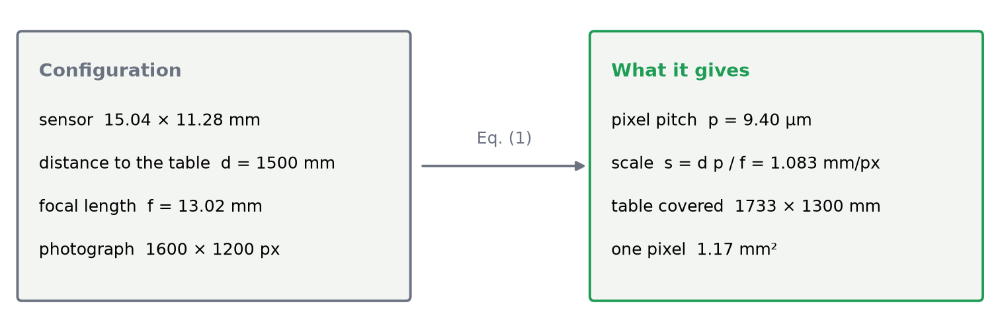
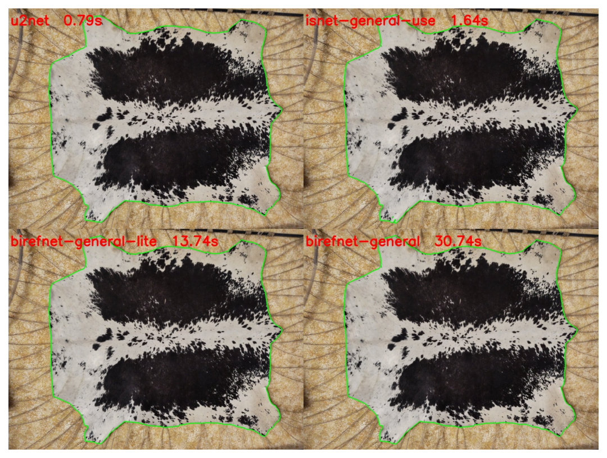
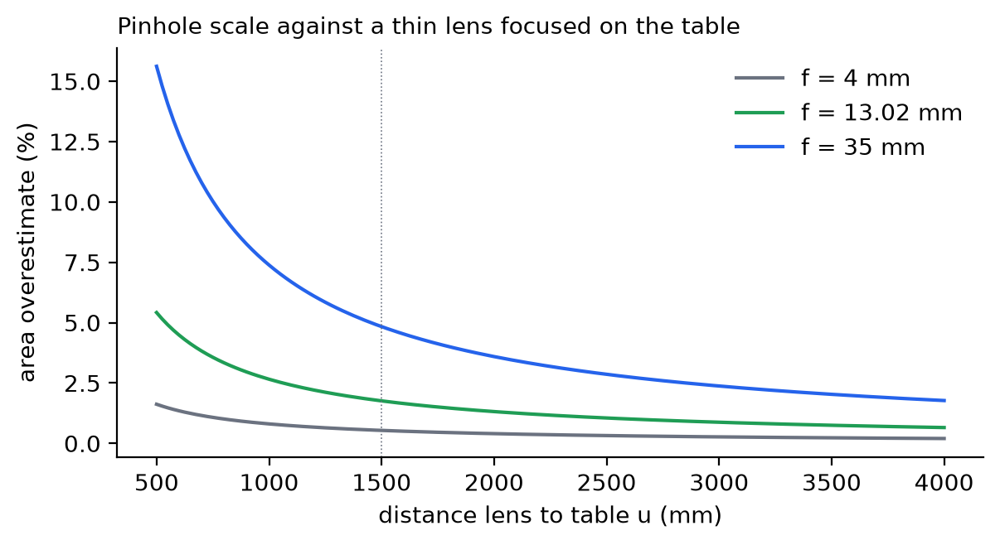
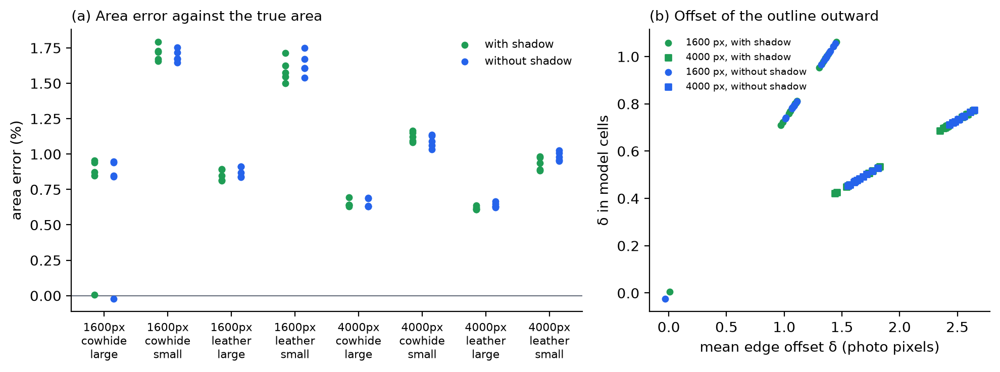
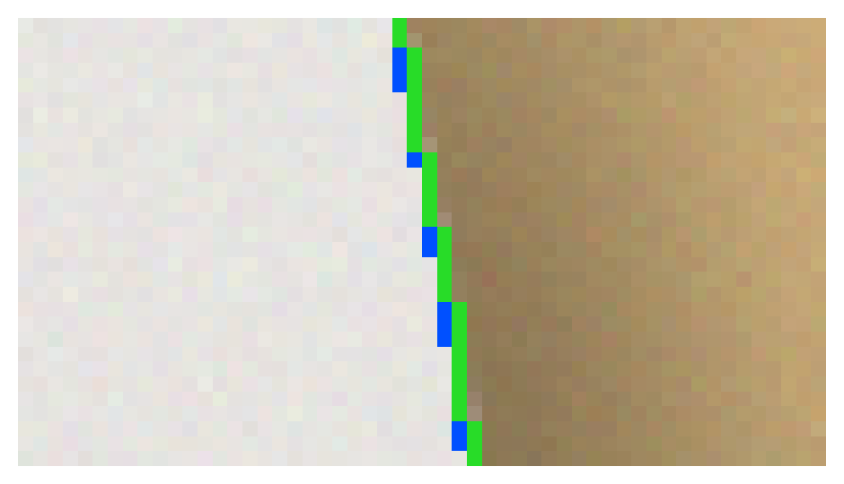
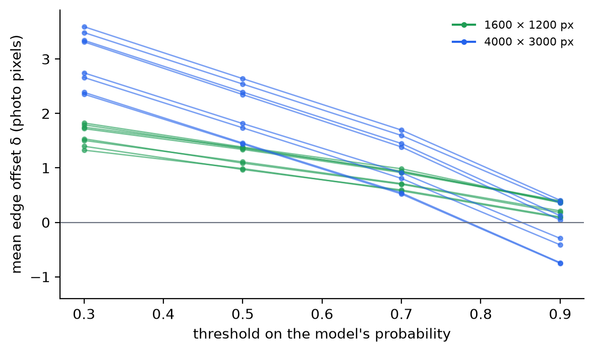
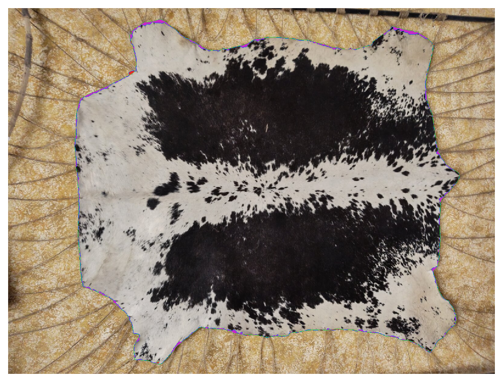

## Abstract

Hides and skins are traded by surface area. We present a method that
measures that area from one photograph taken straight down onto a table,
with a minimal configuration: the distance from camera to table, the
focal length, and either the sensor size or the pixel size. The first
part of the problem is the exact contour of the hide. A classical OpenCV
pipeline was not precise enough where the hide's edge is close to the
table's colour, so we compared four class-agnostic segmentation networks
and integrated IS-Net. On synthetic photographs of known area its outline
lies closer to the true edge than that of the faster U²-Net, but on four
multi-coloured hides of a second set IS-Net alone takes part of the hide
for background, where U²-Net does not. A second, classical step therefore
finds the background from the image border, on a shrunk and
median-filtered copy, and replaces the network's region when the object
it leaves holds at least 95 % of that region and is more than 10 %
larger. The second part turns the pixels inside the contour into square
millimetres, by the central projection of a plane parallel to the sensor,
completed by the camera data in the photograph's metadata. On synthetic
shapes of the same kind the contour's area error varies by less than
0.1 % in all but one configuration and is biased outward by 0.6–1.8 %.
The background step repairs the four failed hides and fails where the
support does not fill the frame. An uncertainty budget shows that the
optics dominate unless the scale is calibrated on a reference of hide
size.

## 1. Introduction

### 1.1 The industrial problem

In the leather industry raw hides, crust and finished leather are bought
and sold by surface, in square metres or square feet
(1 ft² = 0.09290304 m², exactly). The surface also bounds what can be cut
from a hide. A hide is not a simple shape. It has legs, a neck and a tail
region, an irregular and often curled edge, sometimes holes, and a colour
that may be patterned, dark, or close to that of its support.

Industrial measurement uses dedicated machines. ISO 11646 [12] (IULTCS/IUP
32) specifies the reference method for dressed and other dry flexible
leathers: a mechanical pin-wheel machine, checked with templates whose area
lies within ±50 % of the leather measured. ISO 19076 [17] specifies the
method for electronic machines, whose opto-electronic sensor arrays or
digital cameras detect the leather, for dry and wet flexible leather. Both
standards describe dedicated measuring machines.

### 1.2 The challenge: area from a minimal configuration

A camera above an ordinary table needs no such machine. It keeps a
photograph of every measurement as evidence and gives the outline as
geometry for cutting. The challenge we address is to obtain a correct area
from such a set-up with the **least possible configuration**: three values
the operator can know without a calibration laboratory.

- the **distance** from the camera to the table;
- the **focal length** of the lens;
- the **sensor**, given either by its size or by the size of one pixel.

The problem then splits into two independent sub-problems, which give this
article its structure:

1. **Contour detection** (Section 3): which pixels of the photograph belong
   to the hide?
2. **From pixels to area** (Section 4): what surface on the table does each
   of those pixels represent? This is the physics, mathematics and optics
   of the measurement.

Section 2 states the problem and its configuration. Section 5 describes
the implementation. Section 6 evaluates both parts, and Section 7 discusses
their limits.

---

## 2. Problem statement

**Input.** One photograph of a hide lying flat on a table, taken by a
camera whose optical axis is perpendicular to the table, and the minimal
configuration of Section 1.2. The photograph's own pixel count is always
known. Its EXIF metadata [13] may also carry the focal length and the
sensor geometry.

**Output.** The area of the hide in mm², its outline (with holes) as
geometry in millimetres, and a record that allows the measurement to be
checked again.

**Assumptions.** The hide is flat. The camera is perpendicular to the
table. The whole hide is in the picture, with table around it. The table
differs visibly from the hide.

**Target.** Where trade measurement of leather area is under legal
control, the European Measuring Instruments Directive sets the maximum
permissible error of an area measuring instrument at 1.0 %, but not less
than 1 dm² [18]. We use this figure as the reference against which to judge
the results.

Fig. 1 shows what the three values give for a photograph of
1600 × 1200 pixels: the pixel pitch, the size of one pixel on the table,
and the part of the table the photograph covers.

---

## 3. Part I — Contour detection

### 3.1 The classical approach with OpenCV

The first implementation used OpenCV [16]. It took the table's colour as
the median of a band along the image border, in CIELAB. It thresholded
each pixel's colour distance to that colour with Otsu's method [4] and
cleaned the result morphologically. It refined the result with GrabCut [5],
kept the largest region, and traced the contour with `findContours`, which
implements border following [6].

On real photographs this was not precise enough. On a cowhide (Fig. 2)
the outline cut into the hide where its pale edge is close to the table's
colour, and took in a piece of the table at a leg. The method has three
structural weaknesses:

- a single colour model of the table is wrong under shading;
- a shadow is rejected only where it reaches the image border;
- parts of the hide whose colour is close to the table's are lost.

These are limits of colour statistics, not of contour tracing. The tracing
itself (`findContours`) is precise, and the method still uses it. What had to
change was the decision *which pixels are hide*.

### 3.2 Deep segmentation models: the comparison

We replaced the colour statistics with a learned, **class-agnostic**
segmentation network. Such a network separates the foreground object of a
photograph from its background without being told what the object is,
which suits hides of any colour on any table. Four open models were
compared on two sample photographs, the black calf skin and the cowhide
(`model_comparison` in this article's folder): U²-Net [2], IS-Net [1]
(the "general use" weights of dichotomous image segmentation),
BiRefNet-lite and BiRefNet [3]. For the comparison all four ran through
`rembg` 2.0.86 with the same weights (ONNX, onnxruntime 1.31.1, on an
Intel Core i7-10510U CPU with 4 cores and 8 threads, no GPU), one call
after a warm-up. Each mask was thresholded at
50 % and traced with `findContours`.

| Model | black calf (1334 × 1602) | cowhide (1600 × 1200) |
|---|---|---|
| U²-Net | 0.53 s | 0.79 s |
| IS-Net (general use) | 1.48 s | 1.64 s |
| BiRefNet-lite | 11.25 s | 13.74 s |
| BiRefNet | 22.71 s | 30.74 s |

*Table 1 — Run time per photograph of the four candidate models (rembg, 2026-11-05).*

The findings are as follows:

- **The four masks agree closely.** Their pairwise IoU is 0.9958 to 0.9990
  on the black calf and 0.9944 to 0.9981 on the cowhide. U²-Net's mask is
  in the three lowest pairs on both photographs.
- On the cowhide all four leave the table out (Fig. 3).
- IS-Net traces 2 contours on the calf and 4 on the cowhide, U²-Net one
  on each. On the cowhide IS-Net's extra contours are a few tiny specks,
  which a minimum-area filter removes.
- BiRefNet gives no visible gain in precision on these photographs, at
  7.6 to 18.7 times the run time of IS-Net.

### 3.3 Selection of IS-Net

Table 1 rules out BiRefNet: its masks match the others at 7.6 to 18.7
times the run time of IS-Net. We compared the remaining two, U²-Net and IS-Net,
on photographs of known area (`accuracy.py`; every photograph is in
`model_accuracy.csv`): the 40 synthetic photographs of
Section 6.1 and the 40 of the second generator of Section 6.3. Steps 2 to 4
of Section 3.4 were the same for every run, with the background check off,
so that the network alone is measured. Step 1, the inference, was this
article's for IS-Net; for U²-Net, rembg's pipeline replaced it.

- **Synthetic set: IS-Net is closer.** Its mean area error is +1.03 %, its
  outline 1.6 px outside the true edge on average. U²-Net's error is
  +1.45 %, at 2.4 px. IS-Net is over 1 % on 15 of the 40 photographs,
  U²-Net on 29. Neither is off by more than 5 %.
- **Second set: U²-Net does not fail.** Its worst photograph reads −2.72 %
  and its mean error is +0.17 %. IS-Net alone fails on four hair hides, by
  −22 % to −61 %: the figure–ground inversion of Section 6.3. Without those
  four its mean error is +0.08 %.
- **U²-Net is two to three times as fast.** Steps 1 to 4, each network
  with its own step 1, took a median of
  1.10 s against 2.34 s on the synthetic set, and 0.67 s against 2.16 s on
  the second. One pass of the network in TorchScript, on 4 threads, took
  0.643 s for U²-Net at 320 × 320 and 1.822 s for IS-Net at 1024 × 1024.

The two networks therefore did not run through the same step 1. IS-Net
ran as this article's TorchScript model, U²-Net as rembg's ONNX model at
320 × 320, and the two pipelines resize, scale and normalise differently.
As a control, rembg's IS-Net ran as well, also with rembg in place of
step 1. Per photograph it differs from the
TorchScript IS-Net by a median of 0.02 percentage points on both sets,
against 0.35 (synthetic) and 0.18 (second) between IS-Net and U²-Net.
Through the same rembg pipeline, IS-Net still lies closer to the true edge
than U²-Net on the synthetic set of Section 6.1: 1.27 px against 2.39 px
on average, a mean error of +0.96 % against +1.45 %, and 18 photographs
over 1 % against 29. On
failures the pipeline matters more: on one inverted hide rembg's IS-Net
reads −0.71 % and the TorchScript one −21.9 %. Which difference between
the pipelines causes this was not tested.

We kept IS-Net with the background check of Section 3.5. As the method
ships it, IS-Net has the smaller edge bias on the synthetic set; the check
changes none of those photographs (Table 2). On the second set the check
repairs the four inversions, which leaves 3 photographs over 1 % and 1 over
5 % (Table 4), against 3 and 0 for U²-Net alone. That one failure, a mat
smaller than the frame, is known (Section 6.3). U²-Net has three
advantages: no gross failure on the second set, two to three times the
speed, and a clean export to TorchScript (`export_u2net.py`; the traced
model gives the same output as the PyTorch model it was traced from). Neither network was run on
real photographs of known area. U²-Net was not run with the background
check, nor through this article's step 1. So the data do not show which is
closer on real hides. U²-Net is the candidate to evaluate next
(Section 7).

IS-Net is built from plain convolutions, so it exports to a single
TorchScript file with `torch.jit.trace` [15], which runs on a CPU without
the model's own code and without a GPU. Its code is published under the
Apache-2.0 licence. The network's code and weights are downloaded from
pinned addresses, checked by their SHA-256, and exported once (Section 5).

### 3.4 From the network's output to a contour

The network gives each pixel a probability of belonging to the object. The
steps that turn this into a contour are:

1. **Inference.** The photograph is converted to RGB, resized to
   1024 × 1024, and normalised as $x/255 - 0.5$. The network's sigmoid
   output is min–max normalised (unless nothing reaches the threshold, so
   that an empty table stays empty), resized back to the photograph's size,
   and thresholded at $\tau = 0.5$.
2. **Topological cleaning.** Pixels belonging to no 2 × 2 block of set
   pixels are cleared, as is one pixel of each diagonal-only contact. Every
   contour is then a simple closed curve.
3. **One surface.** Of the 8-connected regions at least the minimum area
   (100 mm² by default), only the largest is kept. Dust, labels or tools on
   the table must not change the number.
4. **Holes.** A hole (a background region enclosed by the hide) is cut out
   only if it is at least the minimum area *and* its mean probability is
   below 0.2, which means the network sees the table through it. Marks or a
   drawn outline on the hide leave the network unsure, at a mean
   probability of about 0.4, and are filled instead. A real hole showing the
   table measured about 0.07 (Fig. 4).
5. **Background check.** The object is also found from the background
   (Section 3.5). When that object holds the network's region and is clearly
   larger, it replaces the region.
6. **Tracing.** `findContours` [6] traces the outer ring and the holes. The
   Douglas–Peucker algorithm [7] simplifies them within 0.5 mm, and the
   tolerance is halved until the rings are simple and properly nested.

### 3.5 Finding the whole hide from the background

A class-agnostic network decides what the *object* is from appearance. On
a hide of two strongly different colours this decision can go wrong. On a
black and white calf skin on a dark carpet, IS-Net took one black patch for
the object: 4.9 % of the photograph, against about 77 % for the hide
(Fig. 5a). Section 6.3 shows the same inversion on a synthetic cowhide.

The second step therefore models the table instead of the hide. It
assumes that the image border shows the table, that the table is plain,
and that its brightness varies smoothly across the photograph. The
background is whatever matches that model and is connected to the
border; the object is what remains, whatever its colours. The step works
from coarse to fine.

1. **Coarse copy.** The photograph is shrunk to 160 pixels on its longest
   side (area averaging) and median-filtered over 5 × 5 pixels (Fig. 5b).
   One coarse pixel covers 10 photo pixels at 1600 px and 25 at 4000 px.
   Shrinking alone only dilutes a thin line, such as the grid of a cutting
   mat, a plank seam or the texture of a carpet. The median removes it, so
   the table becomes plain and the hide keeps its broad shapes.
2. **Background model.** Each coarse pixel has three features: the
   logarithm of its CIELAB lightness, and the green and red shares of the
   sum of its linear RGB values. A shadow scales all three channels, so it
   shifts the lightness but leaves the shares. Each feature of the table is
   modelled as a quadratic surface plus a fourth-power radial term for
   uneven light and vignetting. The surface is fitted by least squares to a
   band along the image border, 4 % of the smaller side wide. The fit is
   repeated five times, each time without the pixels more than three robust
   standard deviations away ($1.4826$ times the median absolute deviation
   [19]): where the hide reaches into the band, it does not bend the model.
3. **Deviation.** A pixel's deviation is the root of its squared residuals
   over their standard deviations, summed over the three features. A pixel
   up to 1.15 times darker than the model, with the table's colour, is
   forgiven as a contact shadow (Fig. 5c).
4. **Background and object.** The background is the set of areas whose
   deviation is at most 6 and that are 4-connected to the image border. The
   object is the largest 8-connected region of the rest, after an opening.
   Its enclosed areas are filled, except table-like areas of at least four
   coarse pixels, which stay holes.
5. **Fine edge.** At full size the coarse outline is only a region to look
   in. A band of 2.5 coarse pixels on each side of it is left open, and a
   marker watershed [20] on the photograph, median-filtered over 9 × 9
   pixels to remove the lines again, places the edge where the colour
   changes most sharply. That is the hide's edge rather than the soft edge
   of its shadow (Fig. 5d).

**The rule.** The object found from the background replaces the network's
region only when it holds at least 95 % of that region and is more than
10 % larger. Otherwise the network's region stands. That happens when the
two agree up to the edge, when the background step finds nothing, or when
they disagree because too little of the border is plain table, for example
where the hide runs along much of the edge of the photograph. A hide that
only touches the edge in places can still pass the rule, as the spotted
calf below does. Where the background step fails, the rule mostly
keeps the network's region, so the step's result matters only when it
contradicts the network in this one way.

On the spotted calf the rule takes the background's object: 77.3 % of the
photograph. The skin touches the frame at its left and right edges, so this
photograph shows the outline, not a measurable area. Enough table remains
on the border for the background model, and the black patches cut by the
frame are kept. Of the six real sample photographs it changes only that one.
A whole analysis, network included, took a median of 2.3 s at 1600 × 1200
and 7.5 s at 4000 × 3000 on the CPU of Section 3.2.

**Limits.** The step is built on the image border being table, and it fails
where that is not true. A hide that fills the frame, or runs along much of
its edge, leaves too little table at the border. A cutting mat smaller than the frame puts two
backgrounds on the border, and the table beside the mat is then taken for
hide. Parts narrower than about two coarse pixels are removed with the
lines: thin legs, and holes under about 20 photo pixels at 1600 px or
50 at 4000 px. A table close to the hide's colour, or a grey hide that is
only a little darker than a grey table and so looks like a shadow, hides
the edge. In most of these cases the rule keeps the network's region,
because the object found does not hold it or is not larger. The mat smaller
than the frame is the exception: the table strip makes the object larger
while it still holds the network's region (Section 6.3).

![Fig. 5 — The background check on a black and white calf skin on a dark carpet ("Calf fur skin, spotted" by kuerschner, Wikimedia Commons, public domain). (a) IS-Net alone takes one black patch for the object (red). (b) The coarse copy, 160 px on its longest side, median-filtered: the carpet's texture is gone. (c) Deviation of each coarse pixel from the background model, in robust standard deviations; blue: the edge of the background reached from the border (deviation at most 6). (d) The outline after the fine stage, which the rule takes (green).](figures/fig_background.png)

---

## 4. Part II — From the detected contour to the area

### 4.1 Central projection of the table plane

For a camera whose optical axis is perpendicular to a plane at distance
$Z = d$, the pinhole model [8] maps a point $(X, Y)$ of the plane to the
sensor point

$$
x = f\,\frac{X}{d}, \qquad y = f\,\frac{Y}{d}.
$$

Every point of the plane is at the same depth, so the mapping is a uniform
scaling with magnification $m = f/d$. Straight edges stay straight, and
areas scale by $m^2$ everywhere in the field. A sensor pixel of pitch
$p_x \times p_y$ therefore covers, on the table, a rectangle of

$$
s_x = \frac{d\,p_x}{f}, \qquad s_y = \frac{d\,p_y}{f} \qquad [\text{mm/px}]
\qquad\text{(1)}
$$

and the hide, made of $N$ pixels inside the contour of Part I, has the area

$$
A = N\, s_x\, s_y .
\qquad\text{(2)}
$$

Equation (2) is the measurement equation. The area is counted on the
pixels of the mask, not on the simplified polygon, so the reported area is
exactly the mask's. Because $A$ depends on $s_x s_y$, a relative
error $\varepsilon$ in $d$, $p$ or $1/f$ becomes about $2\varepsilon$ in the
area. The outline is mapped with $s_x$ along columns and $s_y$ along rows,
so non-square pixels do not distort the shape.

![Fig. 6 — Geometry of the measurement, in three dimensions. The table plane, the lens and the sensor plane are parallel, and the third dimension is the distance along the optical axis: u from the table to the lens, v from the lens to the sensor. Rays through the lens centre map the area the photograph covers onto the sensor, inverted (green), and one sensor pixel of pitch $p$ onto its footprint $s \times s$ on the table (red, enlarged). Not to scale. The pinhole scale $s_0 = p\,d/f$ approximates the thin-lens scale $s = p\,(u-f)/f$.](figures/fig_geometry.png)

### 4.2 The minimal configuration in practice

Equation (1) needs $d$, $f$ and $p$. The configuration supplies them, and
the photograph can complete it:

- **Pixel count.** It always comes from the photograph, after the EXIF
  orientation is applied. A photograph shown rotated by 90° swaps $s_x$
  and $s_y$.
- **Sensor given by its size.** The pitch is $p = L_\text{sensor}/N_\ell$,
  the sensor's long side over the photograph's long side in pixels. This is
  right for a downscaled photograph too, whatever its orientation. A
  side-ratio mismatch above 2 % is reported as a possible crop.
- **Sensor given by its pixel size.** $p$ is used as given. This is right
  only for a photograph at the sensor's full resolution.
- **Focal length and pitch from the photograph.** When the EXIF data holds
  a valid focal length ([0.1, 2000] mm), it replaces the configured one. A
  pitch from the focal-plane resolution, or else from the 35 mm equivalent
  focal length, replaces the configured pitch when it lies in
  [0.1, 100] µm. The focal-plane resolution describes the sensor at its
  full resolution. When the photograph's pixel-dimension tags give a larger
  original size than the photograph has, the pitch is scaled by the ratio
  of the long sides. A resizing tool that rewrites those tags but keeps the
  focal-plane resolution makes this pitch wrong, and nothing in the
  photograph shows it. The 35 mm route uses crop factor $c = f_{35}/f$, sensor
  diagonal $43.27\,\text{mm}/c$, long side
  $\text{diag}\cdot N_\ell/\sqrt{N_\ell^2+N_s^2}$, and $p$ = long side $/N_\ell$.
  It is approximate, because makers round $f_{35}$. In this route the
  photograph's own $f$ cancels from Eq. (1): $s = 43.27\,\text{mm}\cdot d /
  (f_{35}\sqrt{N_\ell^2+N_s^2})$.
- **Distance.** It always comes from the configuration. A photograph cannot
  know how high the camera was.

Each value carries its source (photograph or configuration), which is
reported with the measurement. The sample cowhide carries no focal-plane
resolution. Its photograph gives $f = 5.56$ mm and $f_{35} = 23$ mm, so the
35 mm route gives $p = 5.23$ µm; with $d = 1500$ mm this is
$s = 1.411$ mm/px.

### 4.3 A real lens focused on the table

A real objective focused on the table forms its image at the distance $v$
given by the thin-lens equation [14]:

$$
\frac{1}{f} = \frac{1}{u} + \frac{1}{v}, \qquad m = \frac{v}{u} = \frac{f}{u - f},
$$

with $u$ the distance from the lens's front principal plane to the table.
The true pixel footprint is $s = p\,(u-f)/f$, while Eq. (1) with $d = u$ gives
$s_0 = p\,u/f$. The pinhole model therefore overestimates the area by

$$
\frac{A_0}{A} - 1 = \left(\frac{u}{u-f}\right)^2 - 1 \approx \frac{2f}{u}.
\qquad\text{(3)}
$$

This is +1.76 % for $f = 13.02$ mm at 1500 mm, +0.75 % for a 5.6 mm phone lens
and +4.8 % for a 35 mm lens (Fig. 7). The EXIF focal length is nominal
(focused at infinity), and where the principal plane lies inside the lens
is unknown. Neither can be read from the photograph. A calibration with a
reference object absorbs both (Section 6.5).

### 4.4 Departures from the ideal geometry

**Tilt.** A sensor tilted by $\theta$ foreshortens a centred hide by
$1-\cos\theta \approx \theta^2/2$: 0.06 % at 2°. Off the axis the depth varies
as $Z \approx d + y\tan\theta$. A hide whose centroid lies $y_0$ from the axis
is therefore mis-measured by $2y_0\tan\theta/d$: **1.4 %** at 2°, 300 mm and
$d = 1500$ mm.

**Lens distortion.** With radial distortion $r_d = r(1 + k_1 r^2)$ [10], an
area element at normalised radius $r$ is scaled by about $1 + 4k_1r^2$. The
coefficients must be measured per lens [9]. The method does not yet
correct for distortion.

**Thickness and relief.** The top of a hide of thickness $t$ lies closer to
the camera: +$2t/d$ in area, 0.67 % for 5 mm at 1500 mm. A fold or a wave
lowers the projected area below that of the leather. The measured quantity
is the projection of the hide on the table plane.

**Hair.** On a hair-on hide, hair can lie beyond the edge of the skin. The
outline then follows the hair as seen from above, not the skin beneath it,
and the area is larger by about the hair's overhang times the perimeter.
Which of the two edges defines the area of a hair-on hide is not settled
here. The synthetic hair hides of Section 6.3 have no hair beyond the skin,
so they do not measure this effect.

---

## 5. Implementation

The method is implemented in Python, with OpenCV [16] for the image
processing and PyTorch [15] for the network, in the scripts published with
this article (Data and code availability). They follow the structure of the
article:

- **The model** (`model/export_isnet.py`). It downloads the code and the
  general-use weights of IS-Net from pinned addresses, checks them by their
  SHA-256, and exports the network to TorchScript (Section 3.3).
- **The contour of Part I** (`algorithm/`). `isnet.py` gives the network's
  probability, `masks.py` the cleaning of step 2 and the hole operations,
  `background.py` the background check, and `contour.py` the steps of
  Section 3.4 with the rule of Section 3.5. `classical.py` is the colour
  pipeline of Section 3.1, kept for the comparison of Section 6.4.
- **The area of Part II** (`algorithm/camera.py`). It completes the
  configuration from the photograph's EXIF data by the rules of
  Section 4.2, and gives the scale, Eq. (1), and the area counted on the
  mask, Eq. (2) (Fig. 8). Each value carries its source, photograph or
  configuration.
- **The experiment** (`experiment/`). `synthetic.py` draws the photographs
  of known area of Section 6.1, and `measure.py` makes every measurement of
  Sections 3.5 and 6.
- **The figures and numbers** (`figures/`). They are drawn from the
  experiment's files, and the analytical numbers of Sections 4 and 6.5 are
  computed.

One command runs the model export, the experiment and the figures, and a
second makes this document. The synthetic photographs are drawn from fixed
seeds, and on them and on the real photographs the method with IS-Net gives
the same numbers on every run, apart from the run times. The classical contour
of Section 3.1 is not as repeatable: between two runs its pixel count
changed on three real photographs (by up to 0.2 %). GrabCut starts its
colour models by k-means, which draws on OpenCV's shared random number
generator, and the scripts do not seed it. Analysing the same photograph
three times in one process changed its count on all three photographs.
With the seed set before each call, every count repeated exactly. The two
photographs of Table 5 did not change between the runs.

---

## 6. Evaluation

### 6.1 Contour accuracy on photographs of known area

A real hide has no exactly known area. To measure Part I alone we
therefore rendered photographs of hide-like shapes whose area is known
exactly.

**Shapes.** Each outline is
$r(\theta) = R\,[1 + \sum_{k=2}^{7} a_k\cos(k\theta+\phi_k) + \sum_{j=1}^{4} 0.22\,e^{-(\theta-\theta_j)^2/2\sigma^2}]$.
It has random harmonics $a_k \le 0.1/\sqrt{k}$, four legs at
$\theta_j = 45°, 135°, 225°, 315°$ ($\sigma = 0.08$ rad), and a horizontal
stretch of 1.2–1.4. An elliptical hole is placed inside. The true area is
the shoelace area of the outline minus the hole.

**Rendering.** Each shape is filled with sub-pixel anti-aliasing over a
textured table. The hide is either cowhide-like (white with black blotches)
or leather-like (brown with shading). A soft shadow and sensor noise
($\sigma = 3$ grey levels) are added.

**Design.** Two resolutions (1600 × 1200 and 4000 × 3000), two looks, two
sizes (about 45 % and 8 % of the frame) and five seeds give 40 photographs,
plus the same 40 without the shadow as a control. The scale is set to
1 mm/px, so Part II plays no role. The contour is that of Sections 3.4 and
3.5, unchanged. Each photograph is analysed
twice: as the application does it, with the background check of
Section 3.5, and by the network alone.

**Metrics.** The area error is $e = (A - A_\text{true})/A_\text{true}$ and
the IoU is taken against the true mask. The mean edge offset
$\delta = (A - A_\text{true})/P$ is the average outward displacement of the
outline that would produce $e$.

| Photo | Look | Size | $e$ mean ± sd (%) | range (%) | $\delta$ (px) | $\delta$ (model cells) | IoU |
|---|---|---|---|---|---|---|---|
| 1600 × 1200 | cowhide | large | +0.72 ± 0.40 ¹ | +0.00 … +0.96 | +1.12 | 0.82 | 0.9923 |
| 1600 × 1200 | cowhide | small | +1.71 ± 0.05 | +1.66 … +1.79 | +1.10 | 0.80 | 0.9911 |
| 1600 × 1200 | leather | large | +0.85 ± 0.04 | +0.81 … +0.89 | +1.34 | 0.98 | 0.9942 |
| 1600 × 1200 | leather | small | +1.59 ± 0.08 | +1.50 … +1.71 | +1.02 | 0.75 | 0.9916 |
| 4000 × 3000 | cowhide | large | +0.65 ± 0.03 | +0.63 … +0.70 | +2.55 | 0.75 | 0.9945 |
| 4000 × 3000 | cowhide | small | +1.12 ± 0.03 | +1.08 … +1.16 | +1.78 | 0.52 | 0.9918 |
| 4000 × 3000 | leather | large | +0.62 ± 0.01 | +0.61 … +0.64 | +2.39 | 0.70 | 0.9944 |
| 4000 × 3000 | leather | small | +0.93 ± 0.05 | +0.88 … +0.98 | +1.51 | 0.44 | 0.9923 |

*Table 2 — Area error of the contour of Part I (IS-Net, then the
background check) on synthetic photographs with a shadow (n = 5 per row).
The background check changed none of these photographs, so the network
alone gives the same numbers. ¹ One photograph reads +0.005 % (Section 6.3).*

Table 2 and Fig. 9 lead to four observations:

1. **A small spread between shapes.** Within a configuration the standard
   deviation is 0.01–0.08 % in area, except for the large cowhides at
   1600 px (0.40 %), where one photograph shows the failure of Section 6.3.
   This is the spread over five different shapes, not a repeatability. The
   software is deterministic, so analysing the same photograph again gives
   the same number. Photographing the same hide again, with another
   placement, light or sensor noise, has not been tested.
2. **A small outward bias.** All 80 photographs but that one read too
   large, by up to +1.79 %. The outline lies 1.0–2.6 photo pixels outside the
   true edge (Fig. 10), which is 0.4–1.0 cell of the network's 1024 × 1024
   grid. This points to the network's working resolution.
3. **Not caused by the shadow.** The control gives the same errors within
   0.07 % on all 40 photographs.
4. **Smaller hides, larger relative error.** At the same offset the
   relative error scales with perimeter over area, as
   $e = \delta P/A$ predicts.

### 6.2 The probability threshold

The first two photographs of each configuration were analysed again at
$\tau \in \{0.3, 0.5, 0.7, 0.9\}$ by the network alone, without the
background check, because the threshold acts on the network (Fig. 11). The offset falls almost
linearly with $\tau$:

| $\tau$ | $\delta$ at 1600 px, mean [range] | $\delta$ at 4000 px, mean [range] |
|---|---|---|
| 0.3 | +1.61 [+1.33, +1.82] | +2.99 [+2.35, +3.59] |
| 0.5 | +1.20 [+0.97, +1.38] | +2.05 [+1.44, +2.64] |
| 0.7 | +0.79 [+0.58, +0.98] | +1.11 [+0.52, +1.69] |
| 0.9 | +0.26 [+0.08, +0.39] | −0.16 [−0.75, +0.40] |

*Table 3 — Edge offset (photo pixels) against the threshold.*

A higher threshold removes most of the bias, but not at every resolution
alike: at $\tau = 0.9$ the outline still lies 0.26 px outside the edge at
1600 px and already 0.16 px inside at 4000 px. We therefore keep
$\tau = 0.5$ and treat the offset as a systematic error that can be
corrected (Section 7).

### 6.3 A failure mode: figure–ground inversion

A class-agnostic model decides what the *object* is from appearance, and a
hide of two strongly different colours can be read either way: the dark
patches as the object and the light hide as background. On the spotted calf
of Fig. 5 the network took one black patch for the object. On the 80
photographs of Section 6.1 it happened only in a small form. On one large
cowhide at 1600 px, a white region between black blotches was cut out as a
hole: 0.95 % of the hide, which the outward bias of the outline cancels to
+0.005 % (−0.02 % without the shadow). The background check leaves that
photograph as it is, because the difference is far below the 10 % of its
rule.

To measure the failure and the check, we used a second generator of
synthetic photographs with true masks (`experiment/generate_hides.py`).
Its 40 photographs show cow, calf, goat and sheep skins, 10 with hair and
30 leather, in 15 colourings from plain to two-tone, speckled and
three-coloured, on six supports: kraft paper, concrete, a grey table, a
white studio sweep, wood, and a green cutting mat.

| 40 photographs | Network alone | With the background check |
|---|---|---|
| median of the absolute area error | 0.13 % | 0.13 % |
| photographs over 1 % | 4 | 3 |
| photographs over 5 % | 4 | 1 |

*Table 4 — The second generator's photographs, against their true masks.*

The check took the background's object on five photographs (Table 4).
On four hair hides, two-tone, speckled or three-coloured, the network had
taken part of the hide for background, from −22 % to −61 %. The check
brings them to within 1.8 %. On the speckled hide of Fig. 12 the error goes
from −60.6 % to −0.5 % and the IoU from 0.394 to 0.995. On the fifth, a tan
leather on a cutting mat smaller than the frame, the check made a correct
measurement wrong: −0.2 % became +80 %. The table beside the mat is a
second background at the border and was taken for hide, the limit
Section 3.5 names. On the other 35 photographs the check changed nothing.

### 6.4 Real photographs: IS-Net against the classical pipeline

Real photographs have no ground truth. We compared the IS-Net contour with
the OpenCV pipeline of Section 3.1, with holes filled in both:

| Photograph | Size (px) | OpenCV − IS-Net area | IoU |
|---|---|---|---|
| cowhide | 1600 × 1200 | −0.75 % | 0.9911 |
| black calf skin | 1334 × 1602 | −0.27 % | 0.9972 |

*Table 5 — The two contour methods on real photographs.*

On these flat, well-contrasted photographs the two methods agree closely
(IoU 0.991–0.997), and the IS-Net area is the larger by 0.27–0.75 %. That
is consistent with the outward offset of Section 6.1. The local errors of
the classical method (Fig. 2) are small in area here. They matter where
the hide's edge is close to the table's colour or the outline takes in
table, as at the cowhide's leg in Fig. 2, and in the reliability of the outline as cutting
geometry. A large disagreement between the two methods would flag a
measurement for checking. The background check of Section 3.5 now handles
the case of Section 6.3 automatically. On the cowhide and the black calf
skin it leaves the network's contour unchanged.

### 6.5 Uncertainty of the area

Following the GUM [11], we combine relative standard uncertainties. Linear
terms are combined in quadrature and doubled for the area, and rectangular
distributions of half-width $a$ contribute $a/\sqrt3$. The inputs marked
*assumed* are typical values, not measurements of an installation.

**A — the minimal configuration with nominal values** (hide of about 2 m²,
$d = 1500$ mm):

| Source | Assumed | Relative standard uncertainty |
|---|---|---|
| distance to an uncertain lens reference | ±10 mm | 0.38 % (length) |
| focal length, actual against nominal | ±2 % | 1.15 % (length) |
| 35 mm-equivalent focal length, maker's rounding | ±2 % | 1.15 % (length) |
| **combined, area** | | **3.4 % ($k = 1$), ±6.7 % ($k = 2$)** |

The budget is for the 35 mm route of Section 4.2, which the sample cowhide
takes. The photograph's own $f$ cancels there, so the two focal-length rows
are not one error counted twice. They are the two independent errors that
remain in $f_{35}$: the lens's actual focal length against the nominal
one, and the rounding of $f_{35}$ to a whole millimetre (23 mm on the
cowhide, up to ±2.2 %).
| *systematic:* thin-lens focus, Eq. (3) | $f = 13$ mm | +1.76 % |
| *systematic:* contour offset, Table 2 | $\tau = 0.5$ | +0.6 … +1.8 % |

**B — calibrated scale.** A flat reference board of known area is measured
once at the working distance, and the configured distance is adjusted until
the board reads correctly. This calibrates the product $d\,p/f$ and absorbs
the distance, focal length, pitch and thin-lens terms of A:

| Source | Assumed | Relative standard uncertainty (area) |
|---|---|---|
| reference board 1000 × 1000 mm | ±0.5 mm per side | 0.04 % |
| contour, spread between shapes | sd, Table 2 | 0.06 % |
| contour offset, board against hide, not corrected | $\delta$ = 1.23 px at 1.41 mm/px, synthetic | 0.20 % |
| repeatability of the photograph (placement, light, noise) | not measured | open |
| thickness, board against hide | ±2 mm | 0.15 % |
| tilt 1°, hide 100 mm off centre | | 0.13 % |
| lens distortion | not measured | open |
| **combined, without the two open rows** | | **≈ 0.29 % ($k = 1$), ≈ ±0.6 % ($k = 2$)** |

The combined value is a lower bound until the two open rows are measured.
The contour-offset row is not random: it is the −0.2 % by which a hide
reads low after calibration on the board, derived below. It is counted
here as an uncertainty because it is left uncorrected. The correction
$A - \hat\delta P$ of Section 7 would remove it, and the row would then
become the uncertainty of $\hat\delta$.

The reference must be of hide size. The contour offset gives a bias
$e = \delta P/A$ that depends on the shape. With $\delta \approx 1.7$ mm, a
500 × 400 mm card reads +1.6 % while a 2.2 m² hide reads +0.50 %. The hide
is given the perimeter-to-area ratio of the synthetic shapes of
Section 6.1, $P/\sqrt{A} = 4.29$, so its perimeter is about 6.4 m. So
calibrating on the card would make every hide read about 1.1 % low. A
1000 × 1000 mm board (+0.70 %) leaves about −0.2 %. ISO 11646 asks the same
of its templates (±50 % of the leather measured) [12].

---

## 7. Discussion

**Part I.** Replacing colour statistics with a class-agnostic network
fixed the failure that motivated it, at the cowhide's pale edge (Fig. 2).
Of the four networks compared, BiRefNet gave no visible gain at 7.6 to
18.7 times the run time of IS-Net. Of the other two, IS-Net lies closer to
the true edge on the synthetic photographs of Section 6.1, while U²-Net is
two to three times as fast and did not fail on the second generator's hides
(Section 3.3). On synthetic shapes IS-Net's area error
varies little and is biased outward by about one model cell. Because the bias is stable, it can
be corrected by $A_\text{corr} = A - \hat\delta P$, with $\hat\delta$
measured on reference shapes, instead of by raising the threshold, whose
effect depends on the resolution (Section 6.2). The figure–ground inversion on two-tone hides is now
handled by finding the background first (Section 3.5). The network and the
classical step fail in different ways. The network can misread the hide's
own colours, while the background step depends on a plain table at the
image border. The rule takes the background's object only when it holds
at least 95 % of the network's region and is more than 10 % larger, so
the network's region stands unless the network has missed a large part
of the hide. One case still defeats the
rule: a mat smaller than the frame,
whose border shows both mat and table. Two further aids remain useful: a
support whose colour differs from both colours of the hide, and the
operator's check of the overlay.

**Part II.** The minimal configuration suffices in principle, because a
plane parallel to the sensor maps with a uniform scale. In practice its
nominal values carry a few per cent of uncertainty (budget A), above the
1.0 % reference of legal metrology [18]. A single calibration on a
reference of hide size brings the expected uncertainty to about ±0.6 %
(budget B), provided the camera is perpendicular, the hide is centred,
lens distortion is small and a new photograph of the same hide gives the
same area. The last two conditions are still to be measured. The ±0.6 % is
an expected uncertainty computed from assumed inputs, not an accuracy
shown on real hides.

**Legal metrology.** The method has not undergone any conformity
assessment. It must not be used to set prices where the law requires a
verified instrument until such an assessment has been passed.

**Validation still needed.** The accuracy statements here are synthetic
(Part I) or analytical (Part II). A metrological validation needs three
things. The first is reference targets of certified area and hide-like
perimeter. The second is real hides measured independently by the method
of ISO 11646 [12] or ISO 19076 [17], or on a calibrated machine. The third
is a repeatability and reproducibility study across operators, lighting
and cameras. ISO 19076, which covers camera-based machines and wet
leather, is the natural frame for this method. The choice of the network
needs the same real hides: U²-Net should be compared with IS-Net on them,
through the same pipeline and with the background check.

**Threats to validity.** The synthetic textures are simpler than real hair
and grain, and the synthetic hair stays inside the skin's outline. The
run times and the agreement of the four models (Table 1) come from two
photographs. The accuracy comparison of U²-Net and IS-Net used synthetic
photographs only, with the two networks run through different pipelines.
The thresholds
of the background check (deviation 6, shadow 1.15, the 95 % and 10 % of
the rule) were tuned on the samples of this study. The real
photographs' camera parameters are only partly known, and all timings come
from one machine.

---

## 8. Conclusion

The area of a hide can be measured from one photograph and a minimal
configuration — distance, focal length and sensor — by solving two problems
separately. For the contour, a classical OpenCV pipeline was not precise
enough. A comparison of four class-agnostic networks led to IS-Net, which
lies closer to the true edge than the faster U²-Net on the synthetic
photographs of Section 6.1. On
synthetic photographs its area error varies by less than 0.1 % between
shapes of the same kind in all but one configuration, with a small outward
bias that can be corrected. Where the network takes the patches
of a spotted hide for the object, a classical step, which finds the table
from the image border on a coarse, median-filtered copy and refines the
edge at full size, recovers the whole hide. For the area, central projection of
the table plane gives a uniform pixel footprint. The minimal configuration
fixes its value, the photograph's metadata completes it, and a calibration
on a hide-sized reference removes the optical errors that the configuration
alone cannot see. The next step is a metrological validation on real hides
against a reference method, with U²-Net as the alternative network to
test there.

---

## Data and code availability

The scripts of Section 5 are published with this article, in the folder
`docs/articles/contorno-area-measurement/scripts` of the Contorno
repository. `scripts/README.md` maps every figure and table to the script
that makes it. The model comparison of Sections 3.2 and 3.3 is in
`scripts/model_comparison`: `compare.py` (Table 1, Fig. 3), `accuracy.py`
(the accuracy of U²-Net and IS-Net) and `export_u2net.py` (the export of
U²-Net to TorchScript). Their images, run times and `model_accuracy.csv`
are in `model_comparison`, with a README. The grid of Fig. 3 was assembled
from the outputs of 2026-11-05 by `grid.py`. The
synthetic photographs of both generators are regenerated deterministically
from their seeds.
The IS-Net code is published under the
Apache-2.0 licence. The general-use weights are fetched from a Hugging Face
mirror that declares Apache-2.0, while the original repository states no
licence for them, and the DIS5K training data has its own terms of use.
U²-Net's code is published under the Apache-2.0 licence. Its weights have
the same standing as IS-Net's: the Hugging Face mirror that
`export_u2net.py` fetches declares Apache-2.0, while the original
repository states no licence for them. Its training data (DUTS-TR) has its
own terms, which were not checked. The weights are not redistributed with
this article. The provenance of the
sample photographs is recorded in `docs/samples/SOURCES.md`.

**Photographs.** The cowhide is "Stretched Cowhide Skin" by Enda012
(commons.wikimedia.org/wiki/File:Stretched_Cowhide_Skin.jpg), licensed under
CC BY 4.0 (creativecommons.org/licenses/by/4.0/); it was resized, and
outlines and colour marks were drawn on it. The black calf skin is
"Kalb schwarzgefaerbt" and the spotted calf skin is "Calf fur skin,
spotted", both by kuerschner, Wikimedia Commons, public domain.

## Statement on the use of generative AI

The author used an AI assistant (Claude, Anthropic) to draft parts of the
text and to write the experiment and figure scripts. The author designed
the study, reviewed and revised the text, checked the results, and takes
full responsibility for the content.

## References

1. X. Qin, H. Dai, X. Hu, D.-P. Fan, L. Shao, L. Van Gool. Highly accurate dichotomous image segmentation. *European Conference on Computer Vision (ECCV)*, 2022.
2. X. Qin, Z. Zhang, C. Huang, M. Dehghan, O. R. Zaiane, M. Jagersand. U²-Net: Going deeper with nested U-structure for salient object detection. *Pattern Recognition* 106, 107404, 2020.
3. P. Zheng, D. Gao, D.-P. Fan, L. Liu, J. Laaksonen, W. Ouyang, N. Sebe. Bilateral reference for high-resolution dichotomous image segmentation. *CAAI Artificial Intelligence Research* 3, 2024.
4. N. Otsu. A threshold selection method from gray-level histograms. *IEEE Transactions on Systems, Man, and Cybernetics* 9(1), 62–66, 1979.
5. C. Rother, V. Kolmogorov, A. Blake. "GrabCut": interactive foreground extraction using iterated graph cuts. *ACM Transactions on Graphics* 23(3), 309–314, 2004.
6. S. Suzuki, K. Abe. Topological structural analysis of digitized binary images by border following. *Computer Vision, Graphics, and Image Processing* 30(1), 32–46, 1985.
7. D. H. Douglas, T. K. Peucker. Algorithms for the reduction of the number of points required to represent a digitized line or its caricature. *Cartographica* 10(2), 112–122, 1973.
8. R. Hartley, A. Zisserman. *Multiple View Geometry in Computer Vision*, 2nd ed. Cambridge University Press, 2004.
9. Z. Zhang. A flexible new technique for camera calibration. *IEEE Transactions on Pattern Analysis and Machine Intelligence* 22(11), 1330–1334, 2000.
10. D. C. Brown. Close-range camera calibration. *Photogrammetric Engineering* 37(8), 855–866, 1971.
11. JCGM 100:2008. *Evaluation of measurement data — Guide to the expression of uncertainty in measurement* (GUM). BIPM, 2008.
12. ISO 11646:2014 (EN ISO 11646:2014, IULTCS/IUP 32). *Leather — Measurement of area*. International Organization for Standardization, 2014.
13. CIPA DC-008-2019 / JEITA CP-3451. *Exchangeable image file format for digital still cameras: Exif Version 2.32*. 2019.
14. E. Hecht. *Optics*, 5th ed. Pearson, 2017.
15. A. Paszke et al. PyTorch: An imperative style, high-performance deep learning library. *Advances in Neural Information Processing Systems 32*, 2019.
16. G. Bradski. The OpenCV Library. *Dr. Dobb's Journal of Software Tools*, 2000.
17. ISO 19076:2023 (EN ISO 19076:2023, IULTCS/IUP 58). *Leather — Measurement of leather surface — Electronic techniques*. International Organization for Standardization, 2023.
18. Directive 2014/32/EU of the European Parliament and of the Council on the harmonisation of the laws of the Member States relating to the making available on the market of measuring instruments (recast), Annex XI (MI-009), area measuring instruments. *Official Journal of the European Union* L 96, 2014.
19. P. J. Rousseeuw, C. Croux. Alternatives to the median absolute deviation. *Journal of the American Statistical Association* 88(424), 1273–1283, 1993.
20. S. Beucher, F. Meyer. The morphological approach to segmentation: the watershed transformation. In E. R. Dougherty (ed.), *Mathematical Morphology in Image Processing*, 433–481. Marcel Dekker, 1993.
