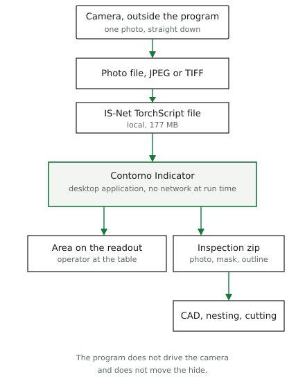
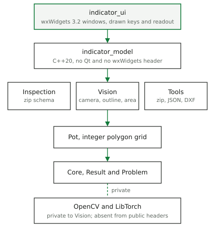
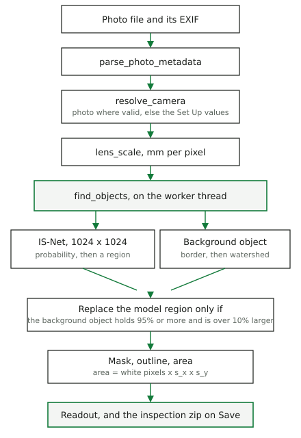
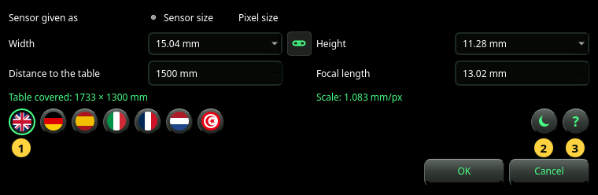

## Abstract

The companion article measures the surface of an animal hide from one
photograph. This paper describes the program that carries that method to
an operator: **Contorno Indicator**, a desktop application on wxWidgets
3.2. The measuring code lives in five C++20 libraries that do not know
the user interface. The application adds a window, a worker thread, seven
languages, and an inspection file that keeps the photograph, the mask and
the outline. OpenCV and LibTorch stay behind one library. A build without
LibTorch still compiles and says, on screen, that it cannot measure.
The program is configured with CMake and Ninja, through buildkit 2.0.0,
and checked by GoogleTest under CTest. The release build of this tree
registers 399 tests.

<div class="first-page-end"></div>

## 1. What this paper is

Two documents describe Contorno, and they answer different questions.

The article *Measuring the surface of animal hides from a single
photograph* (`docs/articles/contorno-area-measurement/`) is the method:
which pixels belong to the hide, and what area those pixels stand for.
Its Python scripts implement that method again, for the figures and the
uncertainty budget. They do not call the C++ libraries.

This paper is the program an operator runs. It states how the method was
allocated to libraries and to the window, which interfaces the parts
share, and which tools produce the executable and the tests. `docs/architecture/architecture.md` is the document for someone who is
about to change the code. Where a count can drift, this paper gives the
date it was read.

The statements of versions, paths and test counts were read from this
tree and from the development machine on 7 November 2026. The physics
(the scale formula, the bias of the outline, the cases where the
background step fails) is not re-measured here. Those numbers stay in
the article.

## 2. Purpose and boundary

Hides are traded by surface. Indicator shows that surface from a
photograph taken straight down onto a table, and it keeps the photograph
as the evidence of the measurement.

The program does not drive the camera, does not move the hide, and does
not use the network while it runs. The IS-Net file and the manual are
local files. Downstream CAD, nesting or cutting is outside the program:
it receives the outline as DXF inside the inspection archive.



The operator at the table needs a number and a way to save the job. Whoever buys or sells the hide needs that number to be the
area of the saved mask, not a second computation. The cutting side needs
the outline in millimetres, in a file a CAD program can open.

## 3. Rules the implementation is built to

There is no separate requirements database. The rules below are the ones
the build and the tests already enforce. Each names the check.

| Rule | Where it is held |
| --- | --- |
| Libraries do not depend on a UI toolkit. | No Qt and no wxWidgets in any `libraries/*/CMakeLists.txt`. |
| OpenCV and LibTorch never appear in a public header. | Both are private dependencies of Vision. Only `Ai_impl.cpp` includes torch. |
| A build without LibTorch still compiles, runs and passes its tests. | `BUILD_VISION_AI`, `ai_available()`. Tests that need the model skip. |
| The application's model layer includes no widget header. | `indicator_model` links only the Contorno libraries. `WxLayers.ModelHasNoToolkit` reads the sources. |
| Library errors are a code plus values, not an English sentence. | `Core::Problem`. The application translates by code (`LibraryText`). |
| Public library functions do not throw across the boundary. | `noexcept` wrappers return `Result<T>`. |
| Without the model, the program measures nothing and says so. | The *Unavailable* state. No second, silent outline method. |
| The number on the readout is the area of the saved mask. | Area is `countNonZero(mask) × s_x × s_y`. The self-test compares the readout with that area. |
| The original photograph is stored untouched. | The inspection zip keeps `original.<ext>` byte for byte. No annotated image is written. |

The last three are product rules. The first six are there so a change to
the window cannot silently change the measurement, and so a machine
without LibTorch is still a coherent build.

## 4. How the program is divided

```
Contorno/
  libraries/            measuring core, no UI toolkit
    Core/               Result<T>, Problem
    Pot/                integer polygon geometry
    Tools/              zip, JSON, DXF
    Vision/             camera, EXIF, segmentation, outline, area
    Inspection/         the inspection zip
  applications/
    Indicator/          the desktop application
      src/model/        thread, settings, messages
      src/ui/           wx windows
```



Vision is the measuring core. Inspection owns the file format and calls
Vision and Tools. The application is two static libraries and then the
executable `contorno-indicator` (CMake target `Indicator`).

`indicator_model` is plain C++20. Text is UTF-8 `std::string`. Paths are
`std::filesystem::path`. It links Tools, Vision and Inspection. The seven
string tables (`strings/indicator_<lang>.cpp`) compile against this
library, so a language can be tested without opening a window.

`indicator_ui` is the wxWidgets layer: the main window, the set-up
dialog, the file dialog, the theme, and the controls that are drawn by
hand. It is the only place that includes wx.

Anything that must be true for a saved inspection — the scale, the mask, the outline, the area — sits
below the toolkit. Anything that is only true of a screen — colours,
languages laid out left to right or right to left, which button is
pressed — sits above it. The worker thread is on the model side and
receives a function that posts its result back. The UI passes
`wxTheApp->CallAfter`, so the result arrives on the thread that owns the
widgets. Tests of the model pass a function of their own and never open
a display.

## 5. Implementation methods

### 5.1 Error reporting

A public call returns `Result<T>`: either a value or a `Problem`. A
problem carries a code (`camera.scale`), an English template used as a
fallback, and named values (`{path}`, `{range}`). The application does
not show the template. `LibraryText` maps the code into the current
language. Paths and text that came from an exception stay as they arrived.

Wrong-side access of a `Result` (reading the value of an error, or the
error of a value) aborts the program, and a test covers it. A forgotten
check therefore stops the program instead of passing on a wrong value,
and a library never has to know the operator's language.

### 5.2 Integer geometry

Pot stores polygons on a grid of 1 µm (`units_per_mm = 1000`):
`Point64`, a closed ring, an outer ring counter-clockwise and holes
clockwise. Integer coordinates make the saved outline bit-for-bit
reproducible. The millimetre values an operator sees are a conversion at
the boundary, not the representation the file is written from.

### 5.3 The chain from the file to the number

The physics is the article's. The program runs it as one sequence.



Distance always comes from the Set Up dialog. Focal length is taken from
the photograph when it falls in [0.1, 2000] mm, and the pixel size when
it falls in [0.1, 100] µm; otherwise the setting is used and the camera
line says why. The scale is

$$s_x = d \cdot p_x / f, \qquad s_y = d \cdot p_y / f.$$

For a photograph shown rotated by 90°, x and y are swapped. This is the
thin-lens scale of a plane parallel to the sensor. It ignores focus
travel and distortion. Both limits are stated in the article and in the
manual; they are not corrected in the code.

The outline is IS-Net, exported once to TorchScript and run on CPU.
`Ai_impl.cpp` converts the image to RGB, resizes it bilinearly to
1024 × 1024, applies \(x/255 - 0.5\), and runs the module. The module is
cached per path behind a mutex. The output is checked for shape and for
finite values, normalised, and resized back. A missing file, a wrong
shape or a non-finite output is a failed analysis, not a zero area.

The mask then follows the article's second step. A threshold of 0.5, a
cleaning of one-pixel spurs, the largest region, and holes kept only when
they are large enough and the model sees the table through them. On a
spotted hide the network can take the dark patches for the object. A
classical background step, on a shrunk and median-filtered copy, may
replace that region when it holds at least 95 % of it and is more than
10 % larger. The window then adds a line asking the operator to check
the outline. Where the hide runs along much of the frame, the rule
usually keeps the model's region. A hide that only touches the frame in
places can still have its region replaced.

The area is the count of white pixels in that mask, times \(s_x\) and
\(s_y\). The outline written to DXF is that same mask, simplified within
0.5 mm, so the readout, the PNG and the DXF describe one region.

### 5.4 One analysis at a time

The GUI thread owns every widget. `Analyser` runs `find_objects` on one
worker thread. A request made during a run waits. A newer request
replaces the one that is waiting. The result of a run that a newer
request has made stale is dropped, and the readout stays dimmed until
the new result arrives. The worker does not touch widgets. It hands a
task to the `Post` function it was given, and that function must run the
task asynchronously: the task joins the worker that posted it.

The destructor drops a waiting request and joins the worker. A run
already inside LibTorch is not cancelled. Shutdown waits for it, then
discards the result. `WxWindow.CloseWhileAnalysingIsClean` covers that
path.

At start the program loads settings, language and theme. The states that
follow are the ones the window actually implements.

| State | Readout | Save |
| --- | --- | --- |
| No photo | dashes | refused |
| Analysing | previous value, dimmed | refused |
| Result | area | allowed |
| Saved inspection, reopened | the saved area | allowed |
| Failed | dashes, and the reason | refused |
| AI unavailable | dashes, and why | refused |

Opening a saved inspection does not run the model again. The area on
screen is the area in the file. A new photograph starts an analysis.

### 5.5 The inspection file

Save writes a zip, through Tools, with stored entries only. The parser
checks the CRC, and it rejects absolute names, `..`, duplicates,
encryption, split archives and archives over the size limit. The order
is fixed:

| Entry | What it is |
| --- | --- |
| `original.<ext>` | the photograph's bytes, untouched |
| `mask.png` | 8-bit grey, object 255, same size as the photo |
| `camera.json` | distance, focal length, pixel size, and whether each came from the photo or from settings. Schema `contorno-camera`, version 4 |
| `parameters.json` | minimum area and the 0.5 mm outline tolerance |
| `objects.dxf` | outer ring and holes, layer `OBJECT`, image millimetre frame |
| `result.json` | image size, the two scales, the area, the rings |

The image millimetre frame has x to the right and y up, origin at the
bottom-left of the photograph. A pixel column \(c\) and row \(r\) in an
image of height \(H\) maps to

$$\big((c + 0.5)\, s_x,\; (H - r - 0.5)\, s_y\big).$$

Reading still accepts camera.json versions 1 to 3, as square pixels, and
older hide inspections. Those older files yield the photograph and the
camera only, and they are analysed again. `mask.png` must match the
image size and contain only 0 and 255.

Settings are a separate, smaller file. On Linux, `WxConfigStore` asks
wx for the user config directory. That directory follows
`XDG_CONFIG_HOME`, and the file under it is `indicator.ini`, in
`Contorno/Indicator`. The self-test does not use that file. It uses an
in-memory store, so a test run cannot change the operator's camera.

### 5.6 The window

The main window is a photograph, a second linked view, a control panel
and a status bar. The panel carries the wordmark, four keys, the mask
toggle, the message log and a seven-segment readout. Those keys, the
readout, the log and the progress bar are drawn by the application.
Native controls are used where GTK will take the theme's colours. The
file dialog is a `wxDialog` around `wxGenericFileCtrl`, because the GTK
file chooser does not follow the theme.

{width=92%}

The window icon is compiled into the binary. A path to a PNG is useless
once the process is not started from the source tree, and under Wayland
the desktop does not ask the window for a file. The taskbar icon comes
from the desktop entry `contorno-indicator`, which is also the
application id (`WM_CLASS` on X11, the Wayland app id).

Seven languages are compiled in: English, German, Spanish, Italian,
French, Dutch and Arabic. Strings are keyed (`message.ai.no_model`) and
carry `{placeholders}`. Numbers with units are not translated: Latin
digits, a point as the decimal mark. Arabic sets right-to-left on the
dialogs, the log and the key labels. The main window's geometry does not
mirror. The log stores messages, not already rendered text, so a change
of language rewrites old lines and keeps their times.



The question mark in Set Up opens the manual in the dialog's language.
The file is searched next to the executable, then in the source tree,
then in English. A Chromium-family browser is started as an app window
with a private profile, 1200 × 800, centred on the dialog's screen. If
none of those browsers is present, the system browser is used. If that
fails, the warning names the file.

wx's own strings, those of the file dialog, are not in our tables.
`WxCatalogue.cmake` compiles wx's catalogues into the executable for
German, Spanish, Italian, French, Dutch and Arabic. It prefers the
machine's `wxstd.mo`. If that is missing it downloads the `wx` 3.2.8
`.po`, checks a pinned SHA-256, and compiles it with `msgfmt`. Offline,
or without `msgfmt`, those strings stay in English and the build warns.

### 5.7 What a failure does

The pattern used throughout is: detect a failure
at the boundary that can see it, refuse the measurement or the file,
and leave a message the operator can read in the current language.

| Failure | What the operator gets |
| --- | --- |
| Built without LibTorch, or the model file is missing | The photograph, no area, and a line that says the outline is unavailable and where the file was sought. |
| Model corrupt, wrong shape, or non-finite output | The analysis fails. The previous result stays. |
| Unreadable photograph | The import fails. The previous state stays. |
| Camera value in the file outside the accepted range | The setting is used, and the camera line says the file value was rejected. |
| Damaged or hostile zip | Open is refused, with the entry and the reason. |
| A result that a newer import has superseded | Dropped. The readout stays dimmed. |
| Nothing on the table above the minimum area | Success, area 0, "No object found". |
| The model kept only part of a spotted hide | The background object is measured, and a line asks for the outline to be checked. |
| No browser for the manual | A warning that names the manual file. |

The case that is deliberately not handled by a fallback is the missing
model. A classical-only outline was tried in the work that led to the
article, and it was not accurate enough where the hide is close in
colour to the table. Shipping it as a silent spare would put a different
instrument behind the same readout.

## 6. Tooling

The language of the program is C++20. The build is CMake (3.29 or newer;
3.31.6 on the development machine) with the Ninja generator (1.12.1
here). The compiler this tree is developed with is g++ 14.2.0 on Debian
13. Those three version numbers were read on the development machine. The
versions the build pins are in the tables below.

buildkit 2.0.0 supplies the warnings, GoogleTest, the coverage flags,
the install layout and the version taken from the git tag `vX.Y.Z`
(fallback 1.0.0). `cmake/buildkit.cmake` uses `BUILDKIT_DIR`, else a
checkout at `../buildkit`, else a fetch of tag `v2.0.0`. Contorno
replaces buildkit's library and application macros so that a header-only
library and the wx entry point fit the tree. The executable is created
with `create_application(ENTRY WX_ui)`.

Presets live in `CMakePresets.json`. Each has its own directory under
`build/`.

| Preset | Build type | What it adds |
| --- | --- | --- |
| `default` | Release | the ordinary build |
| `debug` | Debug | |
| `coverage` | Debug | `ENABLE_COVERAGE` (gcov / lcov) |
| `asan` | Debug | AddressSanitizer and UndefinedBehaviorSanitizer |
| `ci` | Release | the continuous-integration directory |

wxWidgets is an installed dependency, found the way buildkit finds a
development package. This machine has 3.2.8, which is also the version
whose translations are pinned. On Linux the UI links GTK 3 (3.24.49
here) so that text fields take the theme's frame and selection colours.
That link is Linux-only. The window tests set `GDK_BACKEND=x11`, because
they read pixels back from the window.

OpenCV is the same kind of dependency: the installed library, or a
fetched archive with a pinned URL and SHA-256 when
`CONTORNO_OPENCV_FETCH` is on. This machine has OpenCV 4.10.0. OpenCV is
used inside Vision for the image, the contours and the morphology. It is
not a public type.

LibTorch is the CPU build 2.12.0. CMake looks in `/opt/libtorch` and
`Torch_DIR`, then in the build tree, and otherwise downloads a zip whose
SHA-256 is in `cmake/TorchSupport.cmake`. A failed download warns and
continues. Vision then builds with `ai_available()` false. The IS-Net
file is not part of `all`. The target `isnet_model` builds it in a
Python virtual environment with `torch==2.12.0`, from the DIS weights,
URL and hash pinned, using the article's export script. The C++ runtime
and the exporter are the same PyTorch minor version on purpose.
The PyTorch documentation marks TorchScript as deprecated in favour of
`torch.export` (read on 7 November 2026). Loading it is confined to
`ai_probability_impl`, which is the function a later runtime would have
to replace.

Other tools, used at build or check time and not linked into the
measurement:

| Tool | Role |
| --- | --- |
| Python 3 | model export; `build_manual.py --check`; `check_sources.py` |
| GNU gettext `msgfmt` | wx's own translations, when the `.mo` is not already installed |
| `rsvg-convert` | PNG sizes of the desktop icon from the SVG |
| `update-desktop-database` | registers the build-tree desktop entry under `~/.local/share` |
| Pandoc and Chromium | this paper and the measurement article, HTML then PDF |
| GoogleTest | the unit tests |
| CTest | runs them, including the manual check and the self-test |

`BUILD_WX_UI` defaults on. Without wxWidgets, or with that option off,
Indicator and its tests are skipped and the libraries still build.
`BUILDKIT_OFFLINE` refuses downloads. A model or a catalogue that cannot
be fetched then degrades as described above, rather than failing the
configure step.

The commands used on this tree:

```sh
cmake --preset default
cmake --build --preset default --target isnet_model   # once
cmake --build --preset default
ctest --preset default
```

## 7. Speed, and the machine it runs on

At run time there is no Python. Indicator is one native process. It
links the Contorno libraries, wxWidgets, GTK 3 on Linux, OpenCV and the
LibTorch CPU libraries. Those torch libraries sit beside the executable
and are found by an RPATH of `$ORIGIN`. The IS-Net file and the manual
are local files. The process does not open a network connection to
measure a hide. Python is used to export the model, to check the manual,
and to produce the measurement article. It is not on the operator's
path.

The article's scripts implement the same method again, so the figures
do not depend on this program. Their times and the program's times are
therefore two readings, not one benchmark repeated.

The article's timings were taken on the same development machine as the
C++ timings below (its Section 3.2 and Section 3.5):

| What was timed | Time |
| --- | --- |
| rembg IS-Net only, cowhide 1600 × 1200, one call after a warm-up | 1.64 s |
| rembg IS-Net only, black calf 1334 × 1602, same conditions | 1.48 s |
| TorchScript forward alone, 1024 × 1024, 4 threads, median of 5 after a warm-up | 1.822 s |
| Whole Python analysis, network and background check, median at 1600 × 1200 | 2.3 s |
| The same, median at 4000 × 3000 | 7.5 s |

The C++ path was timed on 7 November 2026 on the development machine,
an Intel Core i7-10510U (4 cores, 8 threads, no GPU used). A small
program linked to the release build of Vision called `find_objects`
with the background check on, the outline tolerance at 0.5 mm, and a
scale of 1 mm/px. The scale enters only the minimum-area filter, which
turns a minimum in mm² into a pixel count; it does not change the
network's input. One
warm-up was discarded. LibTorch reported 4 threads, which is the default
it chose on this CPU. The median of the five runs:

| Photograph | Size | Median | The five runs |
| --- | --- | --- | --- |
| `cowhide_stretched.jpg` | 1600 × 1200 | 2.69 s | 2.56–2.81 s |
| `calf_black.jpg` | 1334 × 1602 | 2.64 s | 2.57–2.70 s |

The manual's capture of that same cowhide, inside the real window,
logged 2.9 s. One run, with the file read and the result posted back to
the interface, beside a median of 2.69 s for the library call alone.

These timings are not one benchmark. The 2.3 s is a median over the
article's set of 1600 × 1200 photographs, in Python. The 2.69 s is five
runs of one file, in C++. The rembg lines are the network call only, so
they sit closer to the 1.822 s forward than to a whole analysis. On a
photograph of this size the native program takes about two and a half
seconds, and most of that is the 1024 × 1024 forward.

## 8. How it is checked

Verification here means: does the program we built match the rules in
section 3? Validation against a certified area, on real hides, is the
open measurement of the article. It has not been done. The software
tests do not stand in for it.

CTest on the release preset registers 399 tests, counted from the
discovery files of `build/default` on 7 November 2026. They add as
follows.

| Suite | Tests | What it is responsible for |
| --- | --- | --- |
| `test_contorno_core` | 18 | `Result`, `Problem` |
| `test_contorno_pot` | 2 | the 1 µm grid |
| `test_contorno_tools` | 28 | zip, including archives written by Python; JSON; DXF |
| `test_contorno_vision` | 74 | the scale, EXIF, the outline on the sample photographs, holes, spotted and speckled hides |
| `test_contorno_inspection` | 14 | the zip schema, older versions, legacy files |
| `test_indicator_model` | 90 | analysis, settings, languages, messages, the manual locator. No display |
| `test_indicator` | 170 | windows on a display: panel, readout, log, file dialog, set-up, languages, right-to-left |
| `indicator_self_test` | 1 | the real `contorno-indicator` process |
| `indicator_manual` | 1 | every manual page, its links, and every label it quotes |
| `samples_sources` | 1 | every sample file has a row in `docs/samples/SOURCES.md` |

The self-test is the integration check. It launches `contorno-indicator
--self-test` on `docs/samples/leather/calf_black.jpg` with
`GDK_BACKEND=x11` and a timeout of 300 s. It checks that the window has
its icon and the panel its wordmark, imports the photograph and
waits, checks that the readout shows the area of the result, imports
again while an analysis is running and checks that the readout never
shows a stale number, writes the zip and checks the six entry names and
the DXF rings, opens that zip and checks that no new analysis starts and
that the rings match, then writes a screenshot. Exit code 77 means the
outline is unavailable (no LibTorch, or no model file). CTest treats 77
as a skip, not as a failure. The self-test uses the in-memory settings
store.

The manual check is the other kind of integration. `build_manual.py
--check` builds every page in every language and compares the labels it
quotes with the string tables. A renamed key fails this test, which is
the reason the manual and the translations can be reviewed as text.

What this suite does not do: it does not compare an area with a
reference instrument, it does not run on Windows on every change (the
installers workflow builds the Windows installer, installs it and runs
the self-test on the installed program; macOS is not built), and it
does not treat the duration as a pass or fail. Section 7
is a reading of that duration, not a limit in the test suite. The
application still logs its own seconds with each result.

## 9. What is installed

`cmake --install` on Linux lays the program out as follows. Libraries
are shared, and the LibTorch shared objects are installed beside them
with an RPATH of `$ORIGIN`, so the executable finds them without a
system-wide torch.

```
bin/contorno-indicator
lib/libcontorno_*.so    and the LibTorch objects
share/contorno/models/isnet-general-use.pt
share/contorno/manual/
share/contorno/articles/
share/contorno/samples/
share/doc/contorno-indicator/copyright
share/applications/contorno-indicator.desktop
share/icons/hicolor/.../contorno-indicator.png
```

The model, the manual, both articles and the sample photographs are
installed with the application. The last three belong to the user and
live in a data folder: the Windows installer asks for it
(`Documents\Contorno` by default), and on Linux the first start copies
them from `share/contorno` into `~/Documents/Contorno`. The file dialogs
start in its samples. A developer build finds the model and the manual
next to the executable first, then in the source tree, and does not need
an install to run. Building `Indicator` also copies the desktop entry into
the current user's `~/.local/share`, with `Exec` rewritten to the
build-tree binary, so a Wayland session shows the icon before anything
is installed.

## 10. Limits that belong to the system, not to one file

The measurements cited here were made in the article, not repeated for
this paper.

The scale \(d \cdot p / f\) overestimates length by about \(f/(d-f)\):
near +0.87 % in length and +1.76 % in area at 13 mm focal length and
1500 mm distance. A calibration on a known object removes it. The
article also measured an outward bias of the outline, on the order of
0.6 % to 1.8 % of area on the synthetic photographs. A small calibration
card inherits that bias in the wrong direction for a large hide; the
manual asks for a board of about a square metre.

There is no distortion correction. The hide should stay central. Only
the largest object is measured: two hides that touch become one area,
which is a choice made so that one photograph gives one number. The
background step fails when the border of the frame is not background. A
mat smaller than the frame is the case the article shows, at about
+80 % on one synthetic photograph.

TorchScript as a file format is the migration risk. The rest of the
program never includes a torch header, so the risk is local, but it is
real: a future PyTorch may refuse the file the exporter writes today.

The tests fix the behaviour the code has, including that of the
background rule. A test passes as long as the rule behaves as coded,
even on a hide that fills the frame, where the rule is wrong.

## 11. Rebuilding this paper

From `docs/articles/contorno-indicator/`:

```sh
scripts/build_paper.sh
```

The script runs Pandoc, then headless Chromium, and writes
`contorno-indicator.html` and `contorno-indicator.pdf` beside the
Markdown. It uses the stylesheet and the wordmark of the measurement
article, so the two papers print as one series. The figures are the SVG
files in `figures/`. They are drawn to be read down a narrow A4 column.

## Statement on the use of generative AI

The author used an AI assistant (Claude, Anthropic) to draft and revise
parts of the text. The author reviewed and revised the text and takes
full responsibility for the content.
